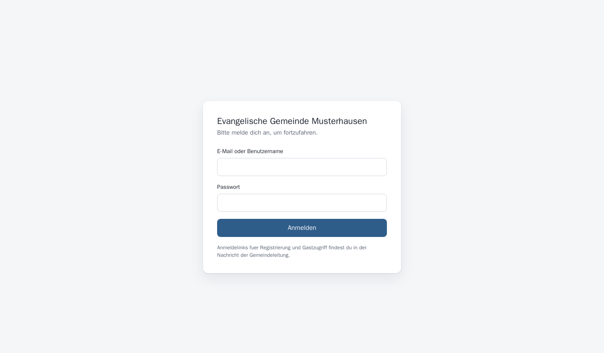
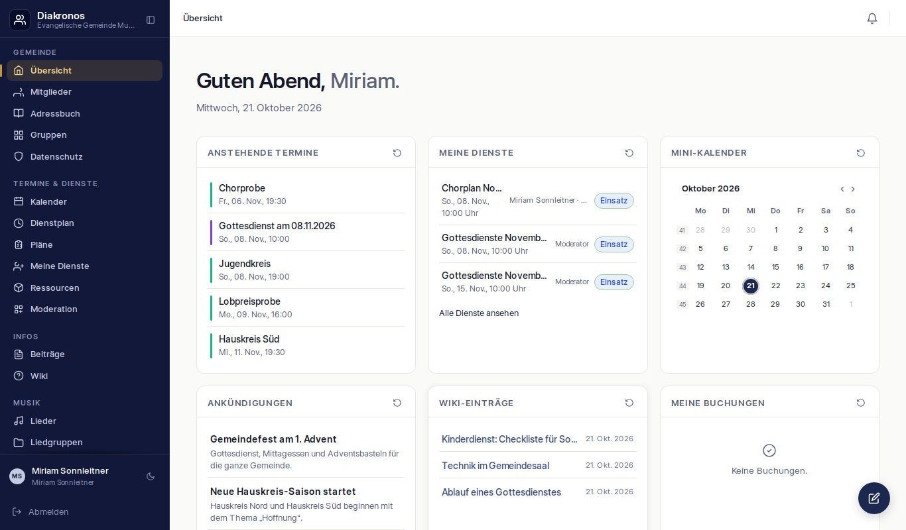
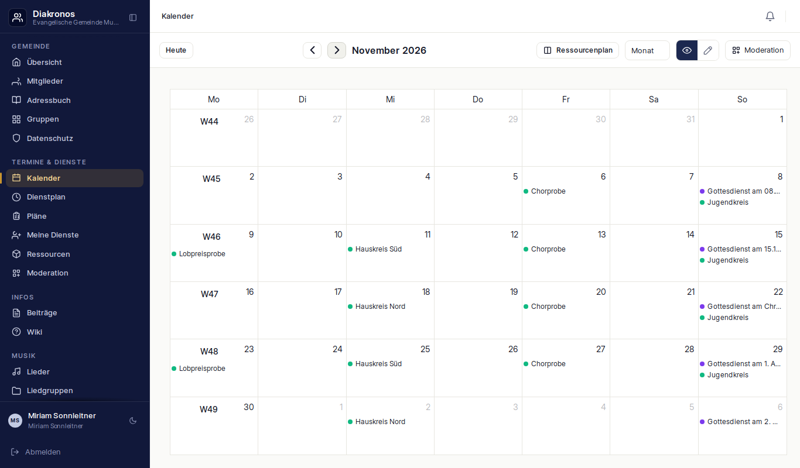
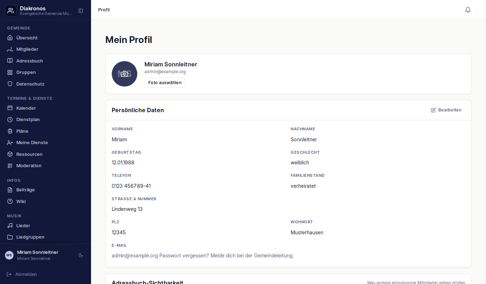

# Betriebsanleitung Diakronos-Standalone

Diese Anleitung richtet sich an die Menschen, die Diakronos **benutzen** und
**pflegen** — nicht an die, die es gebaut haben. Sie beschreibt, was Sie tun
müssen, wenn Sie es installieren, wenn Sie sich nicht anmelden können und
wenn etwas nicht geht.

Alles hier ist am laufenden Stack geprüft; die Abschnitte 8.5–8.8 (Sitzungsende, Sichtbarkeit, Uploads, Gruppenrechte) sind aus dem Quelltext und den zugehörigen Tests belegt und in der Entwickler-Dokumentation (Abschnitt „Sicherheitsregeln B1–B5“) mit Fundstelle nachgewiesen. Was nicht geprüft werden konnte,
steht am Ende unter [Nicht vorhanden / bewusst offen](#9-nicht-vorhanden--bewusst-offen) —
nicht versteckt im Text. Der neue HTTPS-Abschnitt 10 wurde in einem isolierten Testprojekt mit eigener
Test-Zertifizierungsstelle geprüft; ein echter ACME-Abruf bleibt ausdrücklich offen.

---

## Inhalt

1. [Wofür ist das, und was ist es nicht](#1-wofür-ist-das-und-was-ist-es-nicht)
2. [Erste Schritte für einen Administrator](#2-erste-schritte-für-einen-administrator)
3. [Anmelden](#3-anmelden)
4. [Wenn man ausgesperrt ist](#4-wenn-man-ausgesperrt-ist)
5. [Die Oberfläche](#5-die-oberfläche) — darin 5.6 [Kalender importieren (Google / iCal)](#56-kalender-importieren-google--ical)
6. [Kalender im CalDAV-Client einrichten](#6-kalender-im-caldav-client-einrichten)
7. [Wenn etwas nicht geht](#7-wenn-etwas-nicht-geht)
8. [Sicherheit im Betrieb](#8-sicherheit-im-betrieb) — Anmeldesperren (8.1–8.4), Sitzungsende (8.5), Adressbuch-Sichtbarkeit (8.6), Uploads (8.7), Gruppen-Aufgaben (8.8), Internet-Checkliste (8.9), Sicherheits-Kopfzeilen und API-Doku (8.10)
9. [Nicht vorhanden / bewusst offen](#9-nicht-vorhanden--bewusst-offen)
10. [HTTPS und Domain-Betrieb](#10-https-und-domain-betrieb) — darin 10.6 [nginx im laufenden Betrieb aktivieren / zurückrollen](#106-nginx-im-laufenden-betrieb-aktivieren--zurückrollen)
11. [Anmeldung über Authentik (SEC1)](#11-anmeldung-über-authentik-sec1)
12. [Speicherorte konfigurieren und umziehen (SEC1 TEIL D)](#12-speicherorte-konfigurieren-und-umziehen-sec1-teil-d)
13. [Dev-Modus (DM1)](#13-dev-modus-dm1)
14. [Datensicherung (BACKUP-1)](#14-datensicherung-backup-1) — mit Anleitung zum Wiederherstellen
15. [Website-Verwaltung über Primo (WEB-1, optional)](#15-website-verwaltung-über-primo-web-1-optional)
16. [Betrieb unter einem Pfad-Präfix (WEB-5a)](#16-betrieb-unter-einem-pfad-präfix-web-5a) — Website auf `/`, Diakronos unter `/diakronos/…`, darin 16.9 [CSRF-Heilung im Browser](#169-csrf-heilung-was-die-oberfläche-selbst-tut-web-8f-verhaltensänderung)
17. [Kontaktformular der Website (WEB-10)](#17-kontaktformular-der-website-web-10) — sendet nur eine Mail, nichts wird gespeichert

---

## 1. Wofür ist das, und was ist es nicht

Diakronos ist die Software einer Kirchengemeinde. Sie hält Mitglieder, Gruppen,
Dienste, Termine, Lieder und Beiträge. Jeder sieht nur, was für ihn freigegeben ist.

Der Kern besteht aus fünf Containern: `app` (die Anwendung), `db` (die
Datenbank), `redis` (Sitzungen und Sperren), `worker` und `scheduler`
(Hintergrundaufgaben). Neuinstallationen ergänzen `nginx` und `certbot` über
Profil `https`; bestehende Installationen ohne Profil bleiben unverändert HTTP.
TLS-/Domain-Einrichtung: Abschnitt 10.

**Was es nicht ist:**

- **Keine offizielle Frappe-Installation.** Diakronos ist eine *Portierung*.
  Die Bedienoberfläche wurde aus einer Frappe-Anwendung nachgebaut, damit sie
  ohne Frappe läuft. Frappe selbst ist hier **nicht** installiert.
- **Kein öffentliches Internetangebot.** Diese Anleitung beschreibt den Betrieb
  im eigenen Netz. Lesen Sie Abschnitt 8, bevor Sie den Stack irgendwohin
  ins Internet stellen.
- **Keine Installation für Endanwender.** Sie müssen Docker und eine Shell
  bedienen können. Die Benutzerinnen und Benutzer der Gemeinde brauchen
  davon nichts — die brauchen nur einen Browser.

---

## 2. Erste Schritte für einen Administrator

### 2.1 Voraussetzungen

Docker Engine mit `docker compose` (mindestens 2.20, mit `include`), Git. `make` ist optional, alle
Befehle gibt es auch direkt über `docker compose`.

### 2.2 `.env` anlegen

```bash
cp .env.example .env
```

Zwei Werte müssen Sie **immer** setzen, sonst startet der Stack nicht korrekt:

| Variable | Bedeutung |
|---|---|
| `POSTGRES_PASSWORD` | Passwort der Datenbank. Ohne diesen Wert bricht Compose ab. |
| `SECRET_KEY` | Signaturschlüssel der Anwendung und Schlüssel für gespeicherte Zugangsdaten. Eigener Wert aus `openssl rand -hex 32`. Ohne diesen Wert bricht Compose ab. |

Die Zeile `SECRET_KEY=` in der Vorlage bleibt scheinbar leer: erst das Ergebnis
von `openssl rand -hex 32` dahinter eintragen. Ein leerer Wert zählt wie ein
fehlender — Compose meldet dann
„`SECRET_KEY muss in .env gesetzt sein (openssl rand -hex 32)`" und startet nicht.

### 2.3 Den ersten Administrator anlegen (nur bei Erstinstallation)

Eine frische Installation hat **keine** Benutzer. Ohne Benutzer bleibt die
Oberfläche stehen und niemand kann sich anmelden. Dafür gibt es **zwei** Wege —
nehmen Sie den ersten, wenn Sie nicht wissen, welchen:

#### a) Über den Einrichtungslink (empfohlen)

Beim ersten Start erzeugt die App einen einmaligen Link und schreibt ihn als
Kasten ins Log des `app`-Containers:

```bash
docker compose logs app | less
```

```
09:41:03  WARN  Kein Systemadministrator vorhanden

  ┌─ ERSTEINRICHTUNG ────────────────────────────────────────────
  │  Es gibt noch keinen Systemadministrator.
  │  Öffnen Sie diesen Link, um ihn anzulegen
  │  (einmalig gültig, 7 Tage):
  │  https://gemeinde.example.org/diakronos/einrichtung/k7Qe8vT2…
  │  ─────────────────────────────────────────────────────────────
  │  Neuen Link erzeugen:
  │    docker compose exec app diakronos einrichtungslink
  └───────────────────────────────────────────────────────────────
```

Eigenschaften, die Sie kennen sollten:

- Der Link ist **einmalig** und **7 Tage** gültig. Der Server kennt ihn nur als
  Hash — ein Auszug aus der Datenbank enthält keinen benutzbaren Link.
- **Der Link ist der Schlüssel.** Wer ihn hat, kann den Administrator anlegen.
  Geben Sie ihn nicht weiter und nicht in ein Ticket oder eine Chat-Gruppe.
- Fehlt `APP_BASE_URL` in der `.env`, steht im Kasten statt der vollen Adresse
  nur ein Pfad (plus Hinweis). Setzen Sie `APP_BASE_URL=https://ihre-domain`
  und starten Sie den Stack neu (`docker compose up -d`); der bestehende Link
  bleibt dabei gültig.
- Ein **Neustart** des Stacks macht den Link NICHT ungültig — die Ausgabe
  erscheint bei jedem Start, bis ein Administrator existiert.
- Einen **neuen** Link erzeugen Sie so (der alte wird damit ungültig):

  ```bash
  docker compose exec app diakronos einrichtungslink
  ```

  Der Befehl wirkt nur, solange kein Benutzer existiert; danach meldet er
  „Einrichtung bereits abgeschlossen."

Auf dem Link legen Sie Vorname, Nachname, E-Mail und Passwort fest. Danach ist
der Link verbraucht — ein erneuter Aufruf zeigt „Dieser Einrichtungslink ist
nicht mehr gültig". Die Seite liegt unter `{Adresse}/diakonos/einrichtung/…`
und funktioniert mit und ohne `DIAKRONOS_BASE_PATH`.

> **Werden später alle Benutzer gelöscht**, erscheint beim nächsten Start wieder
> ein Einrichtungslink im Log: die Bedingung ist „keine Benutzer vorhanden", und
> die ist dann wieder erfüllt.

**Der Token steht nicht im Zugriffsprotokoll.** Das Protokoll des
`app`-Containers schreibt den Pfad jeder Anfrage mit — und bei diesem Link *ist*
der Pfad das Geheimnis. Die App ersetzt ihn deshalb in der Zeile durch
`/einrichtung/***` (aus `/diakronos/einrichtung/k7Qe8vT2…` wird
`/diakronos/einrichtung/***`); Status, Methode und Dauer bleiben lesbar.

> **Reverse-Proxy-Logs sind ebenfalls betroffen.** nginx, Nginx Proxy Manager
> oder ein Load Balancer vor der App protokollieren den *vollständigen*
> Anforderungspfad — dort steht der Token dann im Klartext, und die App kann
> das nicht verhindern. Wenn Sie den Einrichtungslink nutzen, schützen Sie
> diese Logs (Zugriff nur für Administratoren, Aufbewahrung begrenzen) oder
> schalten Sie die Pfadaufzeichnung für `/einrichtung/` ab. Alternativ den Weg
> (b) über `ADMIN_EMAIL`/`ADMIN_PASSWORD` nehmen — dabei entsteht kein Link.

#### b) Kopflos über `ADMIN_EMAIL` und `ADMIN_PASSWORD`

Für Automatisierung (z. B. ein Skript, das den Stack aufsetzt) können Sie den
Administrator stattdessen in der `.env` vorgeben:

| Variable | Bedeutung |
|---|---|
| `ADMIN_EMAIL` | E-Mail des ersten Administrators. Das ist später auch sein Anmeldename. |
| `ADMIN_PASSWORD` | Sein Passwort. Wird als Argon2-Hash gespeichert, nie im Klartext. |

Zwei Dinge, die hier oft überraschen:

- Der Benutzer wird **nur angelegt, solange die Benutzertabelle leer ist**.
  Sobald ein einziger Benutzer existiert, passiert nichts mehr. Ein gesetztes
  `ADMIN_PASSWORD` kann eine bestehende Installation also **nicht** verändern
  und **kein** zweites Konto anlegen.
- Sind nur *einer* der beiden Werte gesetzt, wird nichts angelegt und **kein**
  Einrichtungs-Link erzeugt (ein halb gesetzter Wert ist gefährlicher als
  keiner). Im Log steht dann eine Warnung — ergänzen Sie den fehlenden Wert
  oder entfernen Sie beide und starten Sie neu.

> Beim Ausprobieren auf einer frischen Testdatenbank: entweder `ADMIN_EMAIL`
> und `ADMIN_PASSWORD` **vor** dem ersten Start setzen — oder den Weg über den
> Einrichtungs-Link (a) nehmen. Die Zeilen können nach dem ersten Start wieder
> entfernt werden.

### 2.4 Starten

```bash
make build      # oder: docker compose build
make up         # oder: docker compose up -d
```

Beim Start zieht der `app`-Container die Datenbankmigrationen automatisch
durch, prüft danach die Erstinstallation aus Abschnitt 2.3 und startet. Ein
frischer `up` ergibt also sofort eine benutzbare Installation.

### 2.5 Prüfen, ob es läuft

```bash
curl -ksS https://localhost/healthz
# erwartet: {"status":"ok","db":true,"redis":true}

curl -ksS -o /dev/null -w '%{http_code}\n' https://localhost/diakonos
# erwartet: 200
# -k nur im lokalen selfsigned-Modus; bei DOMAIN die Domain einsetzen.
```

**Mit Pfad-Präfix** (Abschnitt 15, `DIAKRONOS_BASE_PATH=/diakronos`) liegen
beide Adressen unter dem Präfix — und nur dort:

```bash
curl -ksS https://localhost/diakronos/healthz
curl -ksS -o /dev/null -w '%{http_code}\n' https://localhost/diakronos/diakonos
```

`"db":true` und `"redis":true` heißen: Datenbank und Redis antworten. Steht
dort `false`, läuft der Stack noch nicht richtig — dann hilft nur Abschnitt 7.

### 2.6 Die wichtigsten Befehle im Alltag

| Befehl | Wirkung |
|---|---|
| `make ps` | Status aller Container |
| `make logs` | Protokoll mitverfolgen |
| `make restart` | Neustart |
| `make down` | Stack stoppen |
| `make shell` | Shell im App-Container (für die Notfälle in Abschnitt 4) |

---

## 3. Anmelden

### Persönlichen Zugang für ein Mitglied einrichten (N5)

Unter Mitglieder → Mitglied hinzufügen ist „Einladungslink“ vorausgewählt.
Eine E-Mail-Adresse ist für einen lokalen Zugang nötig. Nach dem Anlegen
siehst du einen persönlichen Link: kopieren, selbst teilen oder als QR-Code
zeigen. Es wird keine E-Mail versendet. Der Link gilt genau sieben Tage und
nur einmal. Teile ihn vertraulich, niemals als öffentlichen Aushang.

Alternativ vergibst du ein Startpasswort (mindestens acht Zeichen). Damit
muss die Person beim ersten Anmelden ein anderes Passwort setzen; vorher
entsteht keine Sitzung und auch CalDAV ist nicht zugänglich. Der dabei
geöffnete Passwortwechsel gilt 15 Minuten; danach erneut mit dem
Startpasswort anmelden. Nach dem Wechsel normal mit dem eigenen Passwort
anmelden. „Kein Zugang“ führt nur einen Mitgliedseintrag.

Ein verlorener oder abgelaufener Link lässt sich beim Mitglied in der Karte
„Zugang“ neu erzeugen; dabei verfällt der vorherige Link. Das Setzen eines
Startpassworts und das Einlösen eines Passwort-Links beenden bestehende
Sitzungen. In der Datenbank liegt nur ein Hash des Einmal-Tokens, nie der
Link selbst. Das Token steht im URL-Fragment (nicht in Server-Zugriffslogs).

Bei aktivem Authentik werden keine lokalen Passwortoptionen angeboten:
Lege nur die Person an, mit derselben E-Mail-Adresse wie beim Anbieter.
Die Verknüpfung erfolgt beim ersten Login. Passwörter pflegst du dort.




Rufen Sie `https://<IHRE-ADRESSE>/diakonos` auf (Altinstallation ohne HTTPS: `http://<IHRE-ADRESSE>:8100/diakonos`). Ohne gültige Anmeldung
erscheint die Anmeldemaske.

Die Maske hat genau zwei Eingabefelder:

| Feld | Was Sie eintragen |
|---|---|
| **E-Mail oder Benutzername** | Ihre E-Mail-Adresse, z. B. `name@gemeinde.de`. |
| **Passwort** | Ihr Passwort. |

Beide Felder sind Pflichtfelder. Oben steht der Gemeindename, darunter der
Hinweis auf die Anmeldelinks aus der Nachricht der Gemeindeleitung.

**Was bei falschem Passwort passiert:** Sie sehen eine Meldung in reinem Text,
keine zweite Anmeldemaske. Die Meldung ist absichtlich nichtssagend und zeigt
keinen Grund an. Laden Sie die Seite neu und versuchen Sie es noch einmal.

### 3.1 Drei Dinge, die Sie wissen sollten

**Ein falsches Passwort und ein gesperrtes Konto sehen gleich aus.** Beides
liefert exakt dieselbe Meldung — es gibt keinen Text, der „Passwort falsch"
von „Konto gesperrt" unterscheidet.

Das ist Absicht: sonst könnte jemand durch Einfrieren der eigenen Adresse
herausfinden, welche Benutzernamen es gibt. Sie sehen deshalb nie einen Hinweis
wie „gesperrt bis 14:32". Wenn Sie fünfmal hintereinander die Meldung bekommen,
sind Sie mit hoher Wahrscheinlichkeit ausgesperrt — gehen Sie zu
[Abschnitt 4](#4-wenn-man-ausgesperrt-ist).

**Fünf Fehlversuche sperren.** Nach fünf Fehlversuchen ist für fünf Minuten
nicht mehr möglich, sich anzumelden — auch nicht mit dem richtigen Passwort.
Jeder weitere Versuch verdoppelt die Wartezeit, bis zu 80 Minuten. Wer sich
zweimal vertippt hat, ist normalerweise noch im Rahmen; wer sich geirrt hat und
dann richtig anmeldet, ist wieder frei — der Erfolg setzt die Zähler zurück.

**Es gibt kein „Passwort vergessen".** Siehe [Abschnitt 4](#4-wenn-man-ausgesperrt-ist)
und [Abschnitt 9](#9-nicht-vorhanden--bewusst-offen).

### 3.2 Abmelden

In der Oberfläche gibt es **keine Abmelde-Schaltfläche**. Der Weg aus der
Anwendung heraus ist: Browserfenster schließen oder den privaten Modus
verlassen. Das Sitzungs-Cookie bleibt dann bis zum Ablauf bestehen
(voreingestellt 24 Stunden, siehe `SESSION_TTL_SECONDS` in der `.env`).

Technisch beendet nur ein direkter Aufruf von `/api/method/logout` die
Sitzung. Wenn Sie für einen gemeinsam genutzten Rechner eine echte
Abmeldung brauchen, ist das derzeit der einzige Weg — eine Schaltfläche
dafür gibt es nicht.

---

## 4. Wenn man ausgesperrt ist

> **Das hier ist der wichtigste Abschnitt der Anleitung.** Er funktioniert
> ohne jede Vorbildung. Alles andere in diesem Kapitel ist ein Kommentar dazu.

### 4.1 Erst prüfen: ist das Konto überhaupt gesperrt?

Sie brauchen eine Shell auf dem Server, im Verzeichnis des Projekts:

```bash
docker compose exec app python -m diakronos_app.loginversuche \
  --entsperren name@gemeinde.de --status
```

Die Antwort ist entweder

- `Nicht gesperrt (Konto sha256:…)` — dann ist das Konto in Ordnung. Suchen Sie
  den Fehler woanders, weiter mit [Abschnitt 7](#7-wenn-etwas-nicht-geht).
- `Gesperrt (Konto sha256:…)` — dann geht es weiter.

> Sie sehen hier keine E-Mail-Adresse, sondern eine lange Zahlenkette. Das ist
> Absicht: das Protokoll soll nicht zur Adressliste werden. Sie müssen den
> Namen trotzdem selbst eintippen, die Kette ist keine Eingabe.

### 4.2 Konto freigeben

```bash
docker compose exec app python -m diakronos_app.loginversuche \
  --entsperren name@gemeinde.de
```

Der Benutzername ist **die E-Mail-Adresse aus dem Anmeldeformular**.

Die Ausgabe sagt, was passiert ist — `Sperre fuer Login und CalDAV aufgehoben`
oder `War nicht gesperrt`. Die Freigabe gilt für die Weboberfläche **und** für
den Kalender-Zugang (Abschnitt 6) gleichzeitig.

**Wichtig für Skripte:** `0` heißt nicht „das Konto ist frei", sondern **„es
steht nichts mehr im Weg"** — es kann also noch eine Adresse sperren. Steht
noch etwas im Weg, endet der Befehl mit **2** und schreibt den Grund nach
Fehlerkanal. Ein Skript, das nur auf `0` wartet, will wissen, ob die Anmeldung
wieder durchgeht; ein Fehler (Exitcode 1) bedeutet, dass **nicht** freigegeben
wurde.

Gibt der Befehl einen **Fehler** mit ungefähr diesem Wortlaut aus:

```
FEHLER: kein Konto mit diesem Namen (sha256:…).
  Der Benutzername ist die E-Mail-Adresse aus dem Anmeldeformular.
```

dann gibt es dieses Konto nicht. Prüfen Sie die Schreibweise der Adresse.
Der Befehl endet in diesem Fall mit einem Exitcode ungleich 0, damit ein
Skript nicht weiterläuft und denkt, es hätte etwas freigegeben. Zweimal
aufrufen ist unschädlich.

### 4.3 Bleibt die Sperre bestehen? Dann war es die Adresse

Kommt danach weiterhin die Meldung von [Abschnitt 3](#3-anmelden), obwohl das
Konto laut Schritt 4.2 frei ist, dann ist **nicht das Konto** gesperrt,
sondern die **Internet-Adresse**.

Das ist hinter einem gemeinsamen Internetanschluss die Regel: Eine Gemeinde hat
meist nur eine Adresse, alle Benutzer teilen sie sich. Fünf Fehlversuche einer
Person sperren dann die ganze Adresse.

Der Befehl sagt Ihnen in diesem Fall, **was** im Weg steht — er unterscheidet
zwei Zustände:

- **GESPERRT** — die Adresse trägt eine Sperre.
- **AUF DER SCHWELLE** — die Adresse hat so viele Fehlversuche, dass der
  **nächste** Versuch sie sperrt. Eine Sperre müssen Sie hier noch gar nicht
  sehen; die Anmeldung scheitert trotzdem.

Beide Fälle machen die Anmeldung zu einem 401, und beide betreffen nicht das
Konto, sondern die Adresse — bei einem gemeinsamen Anschluss also das ganze
Büro. Beheben Sie es so:

```bash
docker compose exec app python -m diakronos_app.loginversuche \
  --entsperren name@gemeinde.de --ip 203.0.113.7 --bestaetigen
```

> **Achtung.** Das gibt **alle** Konten hinter dieser Adresse frei — in einer
> Gemeinde typischerweise das ganze Büro über den gemeinsamen Anschluss. Der
> Befehl sagt das vorher im Klartext und verlangt dafür das Wort
> `--bestaetigen`. Ohne dieses Flag passiert nichts.

Den Wert `--bestaetigen` schreibt man genau so klein, mit Bindestrich.

**Woher bekomme ich die Adresse?** Sie wird **gefragt, nicht geraten**. Aus dem
gesperrten Zustand lässt sie sich nicht auslesen. In den meisten Fällen ist sie
die öffentliche Adresse Ihres eigenen Anschlusses. Prüfen Sie sie im Router
oder fragen Sie jemanden, der sie kennt. Wenn Sie die Adresse nicht sicher
kennen: erst Schritt 4.2 probieren, das fragt nur den Namen und ist der
übliche Fall.

### 4.4 Über die Oberfläche

Wenn sich **ein anderes** Konto anmelden kann, geht es auch ohne Shell:
`/api/method/entsperren.entsperren_konto`. Diese Oberfläche gibt ausschließlich
das **Konto** frei, nie die Adresse — eine Adress-Freigabe im Normalbetrieb
würde ungefragt das halbe Büro mitentsperren.

### 4.5 Was der Notweg nicht kann

Der Notweg setzt **kein Passwort**. Er hebt nur die Sperre auf. Wer ein
Passwort vergessen hat, hat ein anderes Problem — dafür gibt es bewusst
keinen Befehl (Abschnitt 9).

Jede Freigabe wird protokolliert: wer hat freigegeben, für wen (nur als
Pseudonym), welcher Bereich, ob überhaupt etwas zu tun war. Keine
E-Mail-Adressen und keine Passwörter im Protokoll.

Das Entschperren ist selbst begrenzt: 10 Freigaben je 10 Minuten je
Administrator. Ein übernommenes Admin-Konto soll nicht der Knopfdruck für die
Wiederfreigabe sein.

---

## 5. Die Oberfläche



Die Oberfläche ist eine einzelne Seite. Oben links das Suchfeld, links die
Navigation in vier Abschnitten, unten links Ihr Name, rechts der Arbeitsbereich.
Die Startseite (Übersicht) sammelt Kacheln: anstehende Termine, offene Aufgaben,
Mitteilungen und die zuletzt geänderten Einträge. Über „Übersicht bearbeiten"
lassen sich Karten aus- und einblenden sowie einklappen; die Anwendung merkt
sich die Auswahl je Konto.

### 5.1 Die Navigation

Die Einträge kommen aus EINER zentralen Definition (`frontend/src/diakonos/menue.js`);
Seitenleiste (Desktop), „Mehr"-Blatt (Handy) und Kopfleiste lesen dieselbe.

| Abschnitt | Einträge | Wer sie sieht |
|---|---|---|
| **Gemeinde** | Übersicht<br>Mitglieder, Adressbuch, Gruppen — außer für Gäste<br>Datenschutz — nur Administratoren | alle angemeldeten Nutzer |
| **Termine & Dienste** | Kalender<br>Dienstplan, Pläne, Meine Dienste, Ressourcen<br>Moderation — nur Administratoren | alle angemeldeten Nutzer |
| **Infos** | Beiträge, Wiki | alle außer Gästen |
| **Musik** | Lieder, Liedgruppen | alle außer Gästen |
| **Verwaltung** | Einstellungen (Gemeinde, Anmeldung, Rollen & Rechte, Registrierung, Datenschutz-Texte, Dev-Modus) | nur Administratoren |
| | Dev-Befunde | nur mit Tester-Rolle |

**Gäste** (Status „Gast") sehen nur Übersicht, Kalender und Profil. Versuche
sie, eine gesperrte Seite direkt aufzurufen, landen sie auf der Übersicht.

**Administratoren** sehen zusätzlich den Datenschutz-Eintrag und den Abschnitt
VERWALTUNG. Die **Einstellungen** sind der eine Ort für Gemeinde und Technik;
die Abschnitte liegen als Reiter darin (Reihenfolge: Gemeinde, Anmeldung,
Rollen & Rechte, Registrierung, Datenschutz-Texte, Dev-Modus). Den Dev-Modus
sieht nur, wer die Tester-Rolle hat. Die **Anmeldung (Login)** liegt also unter
*Einstellungen → Anmeldung* — nicht mehr unter „Verwaltung → Anmeldung".

Bei „Mitglieder" steht eine Zahl im Feld: das ist die Anzahl offener
Anmeldungen.

Der Abschnitt lässt sich mit dem Feld oben in der Seitenleiste einklappen.

### 5.2 Der Kalender



Links stehen **MEINE KALENDER** — das sind nur die Kalender, für die Sie
Recht haben. Jeder hat ein Kästchen zum Ein- und Ausblenden.

Oben rechts: „Heute" springt zum heutigen Tag, die Pfeile blättern, daneben
steht der Monat. „Monat" wechselt zwischen Monats-, Wochen-, Tages- und
Listenansicht. Der Umschalter daneben (Auge / Stift) wechselt zwischen
**Ansicht** und **Bearbeiten**. „Moderation" ist die Prüfansicht für
Administratoren, „Ressourcenplan" zeigt die belegten Räume und Personen.

**Termine anlegen und ändern.** Ein Klick auf einen Tag (oder Ziehen über
mehrere Stunden) öffnet den Termin-Dialog mit einer vorbelegten Zeit
(Monat 09:00, in der Wochenansicht die geklickte Zeit, Ende jeweils eine
Stunde später). Titel, Beginn und Kalender sind Pflicht. Bei einem
**Serientermin** sind zusätzlich die Wiederholung *und* das Serienende
Pflicht — ohne Serienende würden bis zu 100 Termine entstehen; die
Oberfläche weist darauf hin.

**Wer darf was.** Der Stift-Umschalter und „Neuer Termin" erscheinen nur,
wenn für Ihr Konto mindestens ein Kalender mit Schreibrecht freigegeben ist.
Ohne Schreibrecht zeigt die Kalender-Kopfzeile „Nur lesen"; ein Klick auf
einen Tag öffnet dann nur die Tagesübersicht. Wer schreiben darf, aber den
Kalender **nicht moderiert**, legt zunächst einen **Vorschlag** an, der in
der Terminmoderation geprüft und freigegeben wird.

**Datum und Uhrzeit: so sieht das Feld aus, so liest es die Anwendung.**
Die Eingabefelder für Datum und Uhrzeit sind die **Felder des Browsers**.
Ihre Schreibweise richtet sich deshalb nach der **Sprache des Browsers**,
nicht nach der Sprache der Oberfläche: Mit einem englisch eingestellten
Browser steht im Feld z. B. „12/11/2026" und „05:00 PM", mit einem deutschen
„11.12.2026" und „17:00". Gespeichert wird immer derselbe Wert. Damit niemand
raten muss, steht **unter den Feldern eine deutsche Zeile** („Mi.,
11.12.2026, 17:00–18:00 Uhr") — sie ist die verbindliche Anzeige; das Feld
darüber ist nur die Eingabe. Wer die Felder in deutscher Schreibweise möchte,
stellt im Browser Deutsch ein (dort, wo auch die Rechtschreibprüfung
eingestellt ist).

**Änderungen an bereits festgelegten Terminen.** Ein Schreibberechtigter
ohne Moderationsrecht kann einen festgelegten Termin nur in Kleinigkeiten
(Titel, Beschreibung, Kategorie) sofort ändern. Sobald **Datum, Uhrzeit,
Ort/Ressource, Kalender oder die Ganztags-Markierung** betroffen sind, bleibt
der Termin in der bisherigen Fassung sichtbar; die Änderung wird als
Vorschlag gespeichert („Änderung wartet auf Freigabe") und erscheint in der
Terminmoderation als **alt/neu**-Vergleich. Ein Moderator übernimmt die
Änderung mit „Freigeben" oder verwirft sie mit „Ablehnen".

### 5.3 Die Profilseite



Jedes Mitglied erreicht sein eigenes Profil über „Profil" in der Seitenleiste,
Gäste über das Profil-Symbol oben rechts. Die Seite zeigt die eigenen
Stammdaten und lässt sie bearbeiten:

- **Persönliche Daten** — Vorname, Nachname, Geburtstag, Geschlecht, Telefon,
  Familienstand, Straße, PLZ, Ort, E-Mail. „Bearbeiten" öffnet die Felder,
  „Speichern" schreibt sie zurück.
- **Adressbuch-Sichtbarkeit** — vier Schalter. Sie bestimmen, was *andere
  eingeloggte Mitglieder* sehen dürfen. **Nur eingeschaltete Schalter geben
  ein Feld frei; ohne eigene Angabe sehen andere nichts davon** (auch die
  E-Mail nicht). Eigene Daten sehen Sie immer vollständig. Siehe
  [Abschnitt 8.6](#86-was-mitglieder-im-adressbuch-sehen-sichtbarkeit).
- **Datenschutz** — die Datenschutz-Einwilligung wird bei der Anmeldung
  gesetzt und lässt sich hier **nicht** ändern. Sie zu widerrufen ist ein
  Vorgang mit Folgen (siehe unten).
- **Foto-Einwilligung und Werbeeinwilligung** — zwei Schalter mit je einem
  Widerruf. Jede Umschaltung wird revisionssicher protokolliert.
- **„Einwilligung widerrufen & Daten löschen"** — der DSGVO-Widerruf. Er
  überschreibt die persönlichen Daten mit „Gelöscht", deaktiviert das Konto
  und meldet ab. Die Mitgliedschaft selbst bleibt bestehen — sonst würden
  Mitgliedsbeiträge, Dienstplan und Kinder ebenfalls verschwinden. **Vor dem
  Klick:** der Zugang ist danach weg, und über die Oberfläche lässt er sich
  nicht reaktivieren.

**Wer keinen Mitgliedsdatensatz hat**, sieht hier keine leere Seite, sondern
den Hinweis „Kein Mitglied-Datensatz für diesen Nutzer gefunden." Das ist eine
ehrliche Antwort auf eine unvollständige Zuordnung — etwa bei einem frisch
angelegten Administrator ohne Mitgliedszuordnung. Beheben Sie das in der
Mitgliederverwaltung, nicht auf dieser Seite.

### 5.4 Was Sie nicht dürfen

- **Gesperrte Bereiche sehen Sie gar nicht.** Der Abschnitt VERWALTUNG fehlt im
  Menü, wenn Sie keine Administratorrechte haben. Das ist Absicht.
- **Termine in fremden Kalendern sind unsichtbar.** Ein Kalender, für den Sie
  kein Recht haben, erscheint nicht in Ihrer Liste.
- **CalDAV ist nur lesend.** Über den Kalender-Zugang (Abschnitt 6) lassen
  sich Termine **nicht** anlegen, ändern oder löschen. Das geht nur in der
  Weboberfläche.
- **Unveröffentlichte Beiträge anderer sind unsichtbar.** Ein Beitrag im Entwurf
  ist nur für seinen Autor und für Administratoren erreichbar; für alle anderen
  antwortet die Anwendung wie bei einem nicht vorhandenen Beitrag (404).

### 5.5 Sonstige Seiten

| Seite | Inhalt |
|---|---|
| `#/mitglieder` | Mitgliederliste mit Suche |
| `#/gruppen` | Gruppen und Dienste |
| `#/lieder`, `#/liedgruppen` | Kirchenmusik |
| `#/dienstplan`, `#/planrahmen` | Dienste und Dienstpläne |
| `#/beitraege`, `#/wiki` | Beiträge und interne Wiki |
| `#/mitglieder/datenschutz`, `#/gruppen/organigramm` | Verwaltung (Datenschutz, Organigramm), nur für Administratoren |
| `#/profile` | Ihre eigenen Daten, Sichtbarkeit im Adressbuch, Einwilligungen |

### 5.6 Kalender importieren (Google / iCal)

Architektur und Entwicklerdetails: [GOOGLE-IMPORT.md](GOOGLE-IMPORT.md).

**Ehrlicher Stand:** Der iCal-Import ist live am laufenden Stack gezeigt. Die
Google-Anbindung wurde bisher nur gegen ein **nachgebautes Google** getestet
(Fake-Google in den Tests), **nicht gegen echtes Google**. Der erste echte
Durchlauf ist noch offen; planen Sie dafür einen kleinen Testkalender ein.

**Wer darf.** Das Backend erlaubt den Benutzer `Administrator` sowie die Rollen
`System Manager`, `Mitgliederadministrator` und `Kalenderadministrator`; alle
anderen und Gäste bekommen 403. **Der Link in der Oberfläche** erscheint
dagegen nur für `Administrator` und `Kalenderadministrator`. Wer „nur"
Mitgliederadministrator oder System Manager ist, sieht den Link also nicht
(siehe Tabelle in Abschnitt 7).

**Wo.** Seitenleiste, Bereich KRONOS, Eintrag **„Kalender importieren"**, bzw.
direkt `https://<host>/diakonos#/kalender/import`. Oben wählen Sie zwischen den
Reitern „Google-Kalender" und „iCal-Datei (.ics)".

#### iCal-Datei importieren

1. Reiter **„iCal-Datei (.ics)"** öffnen.
2. Wählen: **neuen Kalender anlegen** (Name und Farbe angeben; gibt es den
   Namen schon, wird ein Suffix angehängt) oder **bestehenden Kalender nutzen**.
3. Eine `.ics`-Datei wählen. Die Seite lehnt leere Dateien und Dateien über
   **5 MiB** ab; zusätzlich prüft der Server gegen `MAX_UPLOAD_BYTES`
   (Vorgabe 10 MB). Geprüft wird der Inhalt: er muss mit `BEGIN:VCALENDAR`
   beginnen und mit `END:VCALENDAR` enden.
4. **„Kalender importieren"** anklicken. Angezeigt werden die Zahl importierter
   und übersprungener Termine.

Gut zu wissen:

- **Dubletten:** Ein erneuter Import derselben Datei in denselben Kalender
  überspringt alles bereits Vorhandene (Abgleich über die Termin-UID). In einen
  *anderen* Kalender importiert dieselbe Datei erneut.
- **Fehlerhafte Datei:** schreibt nichts; der Import ist eine Transaktion.
- **Wiederholungen:** Serien mit `COUNT` oder `UNTIL` (täglich, wöchentlich,
  monatlich, jährlich) werden in Einzeltermine aufgelöst, höchstens 10.000
  Vorkommen, `UNTIL` höchstens 100 Jahre nach Beginn. **Offene Serien ohne
  Ende, `RDATE`, `EXRULE` und Einzelausnahmen (`RECURRENCE-ID`) werden
  abgelehnt**, nicht still gekürzt. Dann im Quellkalender mit Enddatum
  exportieren.
- **Uhrzeiten:** Zeitzonenbehaftete Termine werden in die Kalenderzone
  (`CALENDAR_TIMEZONE`, Vorgabe `Europe/Berlin`) umgerechnet und als lokale
  Uhrzeit gespeichert. Dasselbe gilt für ISO-Zeitangaben mit Offset oder `Z`
  an der Termin-API. Angaben ohne Offset bleiben unveränderte Ortszeiten;
  bestehende Termine werden nicht nachträglich verschoben. Die Speicherung
  ohne Offset kann die doppelte Stunde bei der Herbst-Zeitumstellung nicht
  unterscheiden (z. B. zweimal 02:30 Uhr); für solche Termine bleibt diese
  bekannte Grenze bestehen.

#### Google-Kalender anbinden

Einmaliger Import, **keine Synchronisierung** in beide Richtungen. Die
Zugangsdaten gelten für die ganze Instanz (ein Google-Konto).

**Voraussetzung: HTTPS.** Google akzeptiert als Redirect-URI nur HTTPS (Ausnahme
`localhost`) und keine rohe LAN-IP wie `192.0.2.11`. Der Stack muss also unter
einem Domainnamen mit HTTPS erreichbar sein, in der Regel hinter einem
Reverse-Proxy. Dann `BEHIND_PROXY=1` setzen und den Proxy richtig konfigurieren:
[Abschnitt 8.4](#84-wenn-der-stack-hinter-einem-reverse-proxy-läuft). Hinweis
für den Proxy: Die Rückkehradresse enthält den einmaligen Code in der
Adresszeile (`?code=...&state=...`); schließen Sie diese Query-Strings aus den
Zugriffsprotokollen des Proxys aus.

**Schritt für Schritt:**

1. In der Google Cloud Console ein **Projekt** anlegen oder wählen.
2. Die **„Google Calendar API"** aktivieren.
3. Den **OAuth-Zustimmungsbildschirm** einrichten. Bei einer externen App im
   Testmodus das Google-Konto, dessen Kalender Sie importieren wollen, als
   **Testnutzer** eintragen. Benötigter Scope (nur Lesen):
   `https://www.googleapis.com/auth/calendar.readonly`
4. Einen **OAuth-Client** vom Typ **„Webanwendung"** anlegen. Als autorisierte
   Weiterleitungs-URI **exakt** eintragen:
   `https://<ihr-host>/google-calendar-callback`
   Schema, Host, Port und Pfad müssen mit dem übereinstimmen, was Sie in
   Schritt 5 speichern, ohne Query oder Fragment. Der Pfad ist immer
   `/google-calendar-callback` (andere Pfade lehnt die Anwendung ab).
5. In Diakronos die Importseite öffnen, Reiter **Google-Kalender**: **Client-ID**,
   **Client-Secret** und **Redirect-URI** eintragen, **„Speichern & weiter"**.
   Das Secret wird nie wieder angezeigt. Hinter einem Proxy die öffentliche
   Adresse eintragen, nicht den internen Hostnamen. Ein Wechsel der
   Zugangsdaten setzt eine bestehende Autorisierung zurück.
6. **„Mit Google anmelden"**. Im selben Browser anmelden, Zugriff erlauben; Sie
   kommen zur Importseite zurück. Das muss **innerhalb von 10 Minuten** geschehen.
7. **Kalender auswählen**: je Kalender ankreuzen, Zielkalender (neu oder
   bestehend), Farbe und Zeitraum (alle / ab heute / letztes Jahr / letzte
   3 Jahre) wählen. Höchstens 100 Kalender je Auftrag, 10.000 Termine je Kalender.
8. **Import starten.** Der Import läuft im Hintergrund (Worker); die Seite zeigt
   den Fortschritt und am Ende die Bilanz. Wiederholte Importe in denselben
   Zielkalender überspringen Dubletten. Wenn die Verbindung abreißt oder nach
   elf Minuten keine Abschlussmeldung kommt, zuerst die Kalender prüfen, nicht
   blind erneut starten.

**Wichtig: `SECRET_KEY` nie verlieren oder wechseln.** Client-Secret und
Zugriffstoken werden verschlüsselt (Fernet) in der Datenbank abgelegt; der
Schlüssel wird aus `SECRET_KEY` abgeleitet. Deshalb:

- `SECRET_KEY` sichern, zusammen mit der Datenbank.
- Wechsel oder Verlust: die gespeicherten Google-Zugangsdaten sind nicht mehr
  lesbar. Sie müssen neu eingegeben und neu autorisiert werden. Es gibt keinen
  Klartext-Rückfall.
- Der Platzhalter-Schlüssel (`insecure-dev-key`, die alte Vorgabe der
  Compose-Datei) wird zum Speichern von Google-Zugangsdaten **verweigert**. Seit
  PUB-4f gibt es diesen Ersatzwert nicht mehr: `compose/stack.yml` verlangt
  `SECRET_KEY`, ein fehlender oder leerer Wert bricht den Start mit Meldung ab.
  Eine bestehende `.env`, die noch `insecure-dev-key` enthält, startet zwar,
  kann aber keine Zugangsdaten verschlüsseln — dann einen echten Wert in `.env`
  setzen (Achtung: bereits gespeicherte Zugangsdaten werden dadurch unlesbar,
  siehe oben).
- Derselbe Schlüssel salzt auch die Pseudonyme im Anmelde-Protokoll
  (Auth-Log). Nach einem Wechsel sind diese Pseudonyme neu, alte und neue
  Einträge lassen sich dann nicht mehr einander zuordnen.

---

## 6. Kalender im CalDAV-Client einrichten

Damit Ihre Termine in Thunderbird, Apple Kalender, Outlook oder DAVx⁵
erscheinen, tragen Sie drei Dinge ein:

| Feld | Wert |
|---|---|
| **Server-Adresse** | `http://<IHRE-ADRESSE>:8100/dav/` |
| **Benutzername** | Ihre E-Mail-Adresse — dieselbe wie im Browser |
| **Passwort** | dasselbe Passwort wie im Browser |

**Wichtig:** Es sind dieselben Zugangsdaten. Ein Konto, das im Browser
gesperrt ist, ist auch im Kalender gesperrt — die Sperre gilt für beide
Bereiche gleichzeitig. Auch die Freigabe aus [Abschnitt 4.2](#42-konto-freigeben)
gibt beide frei.

Drei Wege, alle mit denselben Angaben:

**Thunderbird** — Rechtsklick auf „Kalender" in der Ordnerleiste →
„Kalender hinzufügen" → „Netzwerkkalender". Adresse
`http://<IHRE-ADRESSE>:8100/dav/`, Benutzername und Passwort wie oben. Es
erscheinen nur die Kalender, für die Sie Recht haben.

**Apple Kalender** — Menü „Kalender" → „Kalender hinzufügen" bzw. in den
Einstellungen „Accounts" → „Kalender-Account hinzufügen" → „Anderer
CalDAV-Server". Adresse wie oben, Benutzername und Passwort wie oben.

**Outlook** — Datei → Konto einrichten → Anderes Konto → „Mit Kalender
synchronisieren" bzw. CalDAV; Adresse wie oben.

Der Stack bietet auch `/.well-known/caldav` an; es leitet nur auf `/dav/`
weiter. Wenn ein Client nur nach dieser Adresse sucht, geben Sie sie an.

**Nur lesend.** Über CalDAV lassen sich keine Termine anlegen oder ändern.
Neue Termine entstehen in der Weboberfläche, der Kalender-Client übernimmt sie
beim nächsten Abgleich. Termine, die noch Entwurf oder abgesagt sind (bzw. keinen
Status haben), liefert der Server dem Kalender-Client nicht aus — weder in der
Übersicht noch beim direkten Abruf einer einzelnen Termindatei.

---

## 7. Wenn etwas nicht geht

| Was Sie sehen | Ursache | Was Sie tun |
|---|---|---|
| **401 „Deine Anmeldung ist abgelaufen"** | Bei geschützten Methoden fehlt eine gültige Sitzung. Objekt- und Rollenverbote bleiben 403; öffentliche Registrierung bleibt ohne Anmeldung nutzbar. | Im Hinweis „Neu anmelden“ öffnen, mit demselben Konto anmelden und im ursprünglichen Tab „Weiterarbeiten“ wählen. Eingaben bleiben dort erhalten; Speichern wird nicht automatisch wiederholt. |
| **401 obwohl Sie eben noch angemeldet waren** | Ihr Konto wurde deaktiviert oder gelöscht; die Anwendung hat die Sitzung beendet. Wurde das direkt in der Datenbank geändert, greift es nach spätestens 30 Sekunden. | Prüfen, ob das Konto in der Benutzertabelle noch existiert und `enabled` gesetzt ist ([8.5](#85-wann-endet-eine-sitzung-wenn-ein-konto-deaktiviert-oder-gelöscht-wird)). Ist es aktiv, neu anmelden. |
| **Upload abgelehnt** (Meldung etwa „Content-Type … nicht erlaubt (SVG ist gesperrt).", „Dateiinhalt passt nicht zum Content-Type.", „Datei zu gross …", „Kein Schreibzugriff auf das angehaengte Dokument.") | Typ nicht erlaubt (SVG ist gesperrt), Inhalt passt nicht zum Typ, Datei über dem Limit (Vorgabe 10 MB) oder keine Schreibrechte am Zieldokument. | Siehe [8.7](#87-uploads-und-dateien): als PNG/JPEG/GIF/WebP/PDF/ZIP/Text liefern, Größe prüfen, Rechte klären. |
| **Mitgliederliste oder Adressbuch leer, oder Felder wie E-Mail/Telefon leer** | Leere Liste: dem Benutzer ist kein **eindeutiger** Mitgliedsdatensatz zugeordnet (fehlt, oder dieselbe E-Mail gehört mehreren Mitgliedern; dann steht eine Warnung im Protokoll), oder es gibt keine überlappende Gruppe. Leere Felder: die anderen Mitglieder haben sie nicht freigegeben. | Zuordnung in der Mitgliederverwaltung prüfen (`make logs`, Suche nach „Mehrdeutige Mitglied-Zuordnung"). Leere Felder sind gewollt, siehe [8.6](#86-was-mitglieder-im-adressbuch-sehen-sichtbarkeit). |
| **403 beim Sortieren der Mitgliederliste** | Sortierung nach E-Mail, Geburtstag, Wohnort oder Postleitzahl ist Administratoren vorbehalten. | Nach Name sortieren oder als Administrator anmelden. |
| **401 „Ungueltige Anmeldedaten"** | Falsches Passwort **oder** gesperrt. Beides ist nicht unterscheidbar — so ist es gebaut. | Einmal neu laden und neu versuchen. Kommt es wieder, Abschnitt 4. |
| **417 mit „CSRF-Token ungueltig oder fehlend."** | Die Seite im Browser ist veraltet. Der Token passt nicht mehr. | Seite neu laden und den Klick wiederholen. Nicht die alte Seite weiter benutzen. |
| **404 auf `/app/...`** | Diese Seiten gibt es in diesem Stack nicht. Sie stammen aus dem Original (Frappe) und wurden nicht portiert. | Siehe [Abschnitt 9](#9-nicht-vorhanden--bewusst-offen). Der Link bleibt tot. |
| **404 „Methode ... nicht gefunden"** | Falscher oder veralteter Pfad in einer Schnittstelle. | Meist harmlos, wenn eine Kachel „Fehler beim Laden" zeigt: Seite neu laden. |
| **502 oder gar keine Verbindung** | Der Stack läuft nicht. | `docker compose ps` — siehe unten. |
| **„Fehler beim Laden" auf einer Kachel** | Eine einzelne Kachel konnte ihre Daten nicht holen. | „Nochmal" anklicken. Bleibt es, `make logs`. Eine Kachel, die dauerhaft so bleibt, ist seit A1c9 ein Fehler in der Konfiguration — sie steht dann auf einer Funktion, die es nicht gibt, und steht damit auch im Log. |
| **„Kalender importieren" fehlt in der Seitenleiste** | Der Link erscheint nur für `Administrator` und `Kalenderadministrator`. Das Backend erlaubt zusätzlich `System Manager` und `Mitgliederadministrator`, die Oberfläche zeigt ihnen den Link aber nicht. | Rolle prüfen ([5.6](#56-kalender-importieren-google--ical)); ggf. die Rolle `Kalenderadministrator` vergeben. |
| **„OAuth-State ungueltig oder abgelaufen"** (nach Rückkehr von Google erscheint „Google-Verbindung fehlgeschlagen oder abgelaufen. Bitte erneut verbinden.") | Der Zustandswert der Anmeldung gilt **10 Minuten** und genau **einmal**; er ist an Ihre Sitzung und die gespeicherten Zugangsdaten gebunden. Abgelaufen, zweimal verwendet (z. B. Seite neu geladen/Zurück-Taste), andere Sitzung oder zwischenzeitlich geänderte Zugangsdaten. | Auf der Importseite erneut **„Mit Google anmelden"**, im selben Browser, zügig durchklicken. |
| **„Google-Verbindung fehlgeschlagen"** oder Fehler bei Google selbst | Die Anwendung zeigt bewusst nur eine allgemeine Meldung. Häufige Ursachen: Redirect-URI in der Google Console stimmt nicht exakt mit der gespeicherten überein, Konto nicht als Testnutzer eingetragen, falsche Client-ID/-Secret, Google-Quote. | Redirect-URI Zeichen für Zeichen vergleichen, Testnutzer und Zugangsdaten prüfen, Zugangsdaten ggf. neu speichern. Genaueres steht nicht in der Meldung (keine Google-Antworttexte). |
| **417 beim Speichern der Google-Zugangsdaten** | Der Server verweigert das Verschlüsseln, weil `SECRET_KEY` fehlt oder noch den alten Platzhalter `insecure-dev-key` trägt. (417 ist hier eine Fehlermeldung des Servers, nicht das CSRF-Token.) | Echten `SECRET_KEY` in `.env` setzen (ohne ihn startet Compose seit PUB-4f gar nicht mehr), Stack neu erstellen (`docker compose up -d --force-recreate`), erneut speichern. Ein späterer Wechsel macht gespeicherte Google-Zugangsdaten unlesbar, siehe [5.6](#56-kalender-importieren-google--ical). |
| **Google-Import hängt / „Import läuft …" ohne Ende** | Der Import läuft im Hintergrund über einen Worker und Redis. Läuft der Worker nicht, wird der Auftrag eingereiht, aber nie ausgeführt. Das Fortschrittsignal kommt ebenfalls über Redis. | `docker compose ps` (laufen `worker` und `redis`?), `make logs`. Die Seite meldet nach elf Minuten ohne Abschluss keinen Erfolg. Vor einem erneuten Start die Zielkalender prüfen, bereits importierte Termine werden als Dubletten übersprungen. |

**Zu 502 und fehlender Verbindung:**

```bash
cd /pfad/zum/projekt
docker compose ps
```

Steht dort `Exited` oder `Restarting`, starten Sie neu:

```bash
make restart
```

Startet ein Container nicht, sagen die Ursache fast immer die letzten Zeilen:

```bash
make logs
```

Und noch einmal prüfen:

```bash
curl -sk https://<IHRE-ADRESSE>/healthz      # HTTPS-Betrieb (Standard)
curl -s http://<IHRE-ADRESSE>:8100/healthz   # nur HTTP-Betrieb ohne nginx
```

---

## 8. Sicherheit im Betrieb

### 8.1 Was der Schutz tut

Es gibt **zwei** Schwellen, und sie sind nicht zufällig verschieden:

| Zähler | Fehlversuche bis zur Sperre | Wirkung |
|---|---|---|
| **je Konto** | **5** | trifft genau den, der sich vertippt hat |
| **je Adresse** | **25** | nur gegen jemanden, der viele Konten durchprobiert |

Gezählt wird getrennt; gesperrt ist, sobald **eine** der beiden Schwellen
erreicht ist. Nach **5 Fehlversuchen am Konto** ist ein Konto für
**5 Minuten** gesperrt, jeder weitere Versuch verdoppelt die Sperrzeit bis
maximal **80 Minuten**. Nach einem **erfolgreichen** Login sind die Zähler
wieder frei — wer sich zweimal vertippt hat, sperrt sich also nicht selbst
aus.

Warum 25 an der Adresse und nicht auch 5: Fünf Fehlversuche sind am Konto
richtig. An einer **Adresse** sperren dieselben fünf das ganze Büro — und
der Zustand lässt sich nicht einmal einem Benutzer zuordnen. 25 Versuche
**über mehrere Konten hinweg** sind der Angriff, den die Adresssperre
abfangen soll (jemand probiert viele Zugangsdaten durch). Für einen
Angreifer kostet 25 fast nichts, für Menschen hinter einem gemeinsamen
Anschluss praktisch nie.

Einstellbar in der `.env` (alle Werte optional, ohne sie gelten die oben):

| Variable | Vorgabe | Bedeutung |
|---|---|---|
| `LOGIN_MAX_VERSUCHE` | 5 | Fehlversuche bis zur Sperre **am Konto** |
| `LOGIN_MAX_VERSUCHE_IP` | 25 | Fehlversuche bis zur Sperre **an der Adresse** |
| `LOGIN_SPERRE_SEKUNDEN` | 300 | Grunddauer in Sekunden |
| `LOGIN_SPERRE_MAX_FAKTOR` | 16 | Deckel der Verdopplung (16 × 5 min = 80 min) |
| `LOGIN_IP_SPERRE_AUCH_PRIVAT` | false | eigene Adressen **doch** sperren (siehe 8.3) |

Ratenbegrenzung der **öffentlichen Registrierung** (P0-4b): die anonymen
Endpunkte (Registrierung/Gast) hatten keine Bremse. Gezählt wird in einem
festen Zeitfenster je Adresse und je Link — ein Fenster, keine Sperre, weil
eine Gemeinde typischerweise **einen** Internetanschluss hat.

| Variable | Vorgabe | Bedeutung |
|---|---|---|
| `REGISTRIERUNG_MAX_IP` | 10 | Absendeversuche je Adresse und Fenster |
| `REGISTRIERUNG_MAX_LINK` | 20 | Absendeversuche je Registrierungslink und Fenster |
| `REGISTRIERUNG_MAX_VALIDIERUNG` | 60 | Aufrufe der öffentlichen Seite je Adresse und Fenster |
| `REGISTRIERUNG_FENSTER_SEKUNDEN` | 3600 | Länge des Fensters (läuft nicht mit) |

`0` heißt ausdrücklich „unbegrenzt“ — der Default ist die Grenze.

Registrierungsfenster benötigen Redis ab Version 7 (Compose verwendet Redis 7).
`INCR` und `EXPIRE NX` werden zusammen in einer Transaktion ausgeführt: Last
verlängert kein Fenster, alte Schlüssel ohne Ablauf erhalten wieder eine TTL.
Die Adressgrenze wird vor jeder Token-Abfrage geprüft; einen Link-Schlüssel
gibt es erst nach erfolgreicher Token-Prüfung, nicht für erfundene Tokens.
Auch der öffentliche Seitenaufruf zählt genau einmal gegen die Prüfgrenze.

**Suche der Befehlspalette (Strg+K).** Die Palette fragt bei jedem Tastendruck;
ein Aufruf liest sieben Quellen (Personen, Gruppen, Termine, Lieder, Wiki,
Beiträge, Einstellungs-Stichworte). Gezählt wird je **Benutzer** in einem
festen Fenster — nicht je Adresse, weil hinter einem Proxy alle
Gemeindeglieder dieselbe Adresse haben. Über der Grenze antwortet der Endpunkt
mit `429` und „Es sind gerade zu viele Suchanfragen eingegangen.“; die Palette
zeigt das und tippt nach kurzer Pause weiter. Nur angemeldete Personen dürfen
suchen (`403` für Gäste). Treffer enthalten **nie** E-Mail-Adressen oder
Telefonnummern; gesucht wird bei Personen ausschließlich über Vor- und
Nachnamen und nur in dem Bereich, den die Person ohnehin sehen darf.

| Variable | Vorgabe | Bedeutung |
|---|---|---|
| `SUCHE_MAX` | 60 | Suchaufrufe je Benutzer und Fenster |
| `SUCHE_FENSTER_SEKUNDEN` | 60 | Länge des Fensters (läuft nicht mit) |

`SUCHE_MAX=0` schaltet die Bremse ausdrücklich ab — der Default ist die Grenze.

Betriebsentscheidung bei Redis-Ausfall (P0-4b K5): bewusst **fail closed**.
Eine öffentliche Registrierung darf nicht ohne wirksame Bremse schreiben.
Besucher sehen „Anmeldungen können gerade nicht verarbeitet werden. Bitte
versuche es später erneut.“ (API: 417, öffentliche Seite: Zugangshinweis),
keine Redis-Adresse und keinen internen Verbindungsfehler. Nach Wiederkehr
kann die Person selbst erneut absenden; es gibt keine automatische Wiederholung.
Hinter einem externen Reverse-Proxy `BEHIND_PROXY=1` setzen und dessen
Vertrauensgrenze wie in 8.4 konfigurieren. Andernfalls ist die private
Proxyadresse absichtlich nicht zählbar; die Linkgrenze allein schützt nicht
vor vielen ungültigen Token-Abfragen. Auch ein bekannter gültiger Link kann
bis zum Ablauf seines Fensters ausgebremst werden; die Grenze ist keine
Identitätsprüfung einzelner Besucher.

> **Ändern Sie diese Werte nicht im laufenden Betrieb, sondern nehmen Sie sie in
> die `.env` auf und starten den Stack neu.**

### 8.1b Schreibende Endpunkte nur per POST (SEC-11)

Jeder Endpunkt, der Daten ändert, eine E-Mail versendet oder ein Token anlegt,
nimmt **ausschließlich POST** an. Ein Aufruf per `GET` — etwa ein Link
`…/api/method/<funktion>?…`, den jemand auf einer fremden Seite anklickt —
führt **nichts** aus:

* im Browser (Navigation) landet die Person auf der Anmeldemaske,
* ein Skript bekommt `405 MethodNotAllowed` mit `Allow: POST`.

Damit ist der klassische CSRF-Weg über `GET` geschlossen — zusätzlich zur
Prüfung des CSRF-Kopfes, die nur bei schreibenden Methoden greift.

Zusätzlich weist der Server jede Anfrage unter `/api/method/…` und
`/api/resource/…` ab (`403 PermissionError`), die ein **Browser von einer
fremden Seite** schickt (`Sec-Fetch-Site: cross-site` oder `same-site`).
Ausgenommen sind ausschließlich die öffentlichen Website-Endpunkte
(`website.*`, `kontakt_senden`) — sie bringen ihre eigene Herkunftsprüfung
mit. Werkzeuge ohne Browser (Apps, CalDAV-Clients, `curl`) senden den Kopf
nicht und sind nicht betroffen.

Die vollständige Einordnung aller Endpunkte (lesend/schreibend) steht in
`backend/src/diakronos_app/frappe_compat/inventar/whitelist.md`; erzeugt wird
sie mit `tools/whitelist_inventar.py`.

### 8.2 Der gemeinsame Internetanschluss — gelöst

Der Zähler hing früher an der Adresse, von der die Anmeldung kommt. Eine
Gemeinde hat typischerweise **einen** Internetanschluss, alle Benutzer
teilen sich dieselbe Adresse — fünf Fehlversuche einer Person sperrten
dann **alle**.

Das ist seit der Umstellung auf zwei Schwellen nicht mehr der Normalfall:

- Fünf Fehlversuche einer Person sperren **nur ihr Konto**. Alle anderen
  können sich anmelden.
- Erst **25** Fehlversuche von derselben Adresse sperren die Adresse — und
  das auch nur, wenn es sich um eine **öffentliche** Adresse handelt.

Damit gilt die Regel an der Konto-Schwelle streng und an der
Adress-Schwelle weit. Das war eine bewusste Entscheidung: die
Kontosperre ist die, die man ohne Diskussion haben will.

### 8.3 Eigene Adressen werden nie gesperrt

Adressen aus diesen Bereichen werden standardmäßig **weder gezählt noch
gesperrt**. Die Tabelle beschreibt die einzige Policy `EIGENE_ADRESSEN` in
`frappe_compat/loginversuche.py`; `ipaddress` prüft echte Netzgrenzen statt
Textpräfixe. `is_private` wird bewusst nicht verwendet: Dokumentationsnetze
wie `203.0.113.0/24` und `2001:db8::/32` bleiben sperrbar (sie sind keine
öffentlich routbaren Netze, dienen hier aber als sperrbare Testadressen).

| Bereich | Bedeutung |
|---|---|
| `127.0.0.0/8` | Loopback |
| `10.0.0.0/8` | privat |
| `172.16.0.0/12` | privat (hier lebt die Docker-Bridge) |
| `192.168.0.0/16` | privat |
| `169.254.0.0/16` | link-local |
| `0.0.0.0/32` | nur die einzelne unspecified-Adresse, nicht ganz `0/8` |
| `::1/128` | IPv6-Loopback |
| `fc00::/7` | IPv6-Unique-Local (Adressen daraus) |
| `fe80::/10` | IPv6-link-local |
| `::/128` | IPv6-unspecified |

IPv6-Schreibweisen, Zonenkennungen und IPv4-mapped IPv6 werden für die
Sperrkennung normalisiert; sie eröffnen keine separaten Zähler.

**Die Kontosperre bleibt davon unberührt** — wer sich fünfmal vertippt,
ist für fünf Minuten draußen, egal von welcher Adresse.

Warum das die richtige Richtung ist:

- **Hinter einem Reverse-Proxy** sieht die Anwendung ohnehin die
  Proxy-Adresse (privat). Sie zu sperren hieße: der nächste Versuch eines
  *beliebigen* Nutzers wird abgewiesen, und der Zustand ist nicht einmal
  einem Benutzer zuzuordnen.
- **Im eigenen Netz** gilt dasselbe: alle Geräte teilen sich die private
  Adresse des Routers. Eine Sperre dort wäre reines Glück.
- **Im Internet** ist die Adresse des Angreifers eine **öffentliche** — die
  wird gezählt und ab 25 gesperrt, genau wie gewollt. Der Schutz
  existiert also dort, wo er etwas nützt.

Eine gültige Adresse aus `X-Forwarded-For` wird genauso behandelt wie eine
direkt gesehene. Ungültige Werte (`kein-ip`, `:`, `999.999.999.999`) sind
**nicht vertrauenswürdig**, werden aber auch nicht als IP-Kennung gezählt
oder gesperrt. Bei `BEHIND_PROXY=1` fällt ein ungültiger erster XFF-Wert auf
den direkten Peer zurück, nicht auf spätere Einträge in der Kette. Ist der
Peer sperrbar, bleibt damit sein IP-Limit erhalten; ist er ein privater
Proxy, bleibt nur die Kontosperre — die Proxy-Adresse darf nicht gesperrt
werden.

**Vertrauensgrenze:** `BEHIND_PROXY=1` ist keine Header-Authentifizierung.
Der vorgeschaltete Proxy muss fremdes XFF überschreiben und der Backend-Port
darf nicht direkt für fremde Clients erreichbar sein. Andernfalls kann ein
Client gültige private Adressen behaupten und so den IP-Zähler umgehen.
Adressvalidierung behebt diese Deployment-Lücke nicht.

Wer seine eigene Infrastruktur doch sperren will, setzt

```
LOGIN_IP_SPERRE_AUCH_PRIVAT=1
```

**Praktisch ist das fast nie sinnvoll:** die Sperre trifft dann *alle*
Benutzer hinter dieser Adresse, also bei einem Gemeindeanschluss das ganze
Büro. Der Schalter ist eine Fluchtklappe, keine Empfehlung.

### 8.4 Wenn der Stack hinter einem Reverse-Proxy läuft

Steht der Stack hinter Nginx, Traefik oder Caddy, sieht die Anwendung für
**alle** Benutzer dieselbe Adresse — die des Proxies. Diese Adresse wird
zwar nicht gesperrt (sie ist privat, siehe 8.3), aber damit wäre die
Adresssperre im Internet **nicht wirksam**: sie würde nie eine Adresse
sehen, die sie sperren darf.

Dann muss in der `.env`:

```
BEHIND_PROXY=1
```

Der Standard ist `0` — ohne diese Zeile wird die Kopfzeile
`X-Forwarded-For` bewusst ignoriert. Grund: jeder Client darf diese Kopfzeile
selbst setzen, und sonst ließe sich die Sperre per Kopfzeile umgehen.

**Beides zusammen ist eine bewusste Fehlkonfiguration.** Wenn Sie
`BEHIND_PROXY=1` setzen, muss der Reverse-Proxy die Kopfzeile
`X-Forwarded-For` auch wirklich setzen und darf sie nicht von fremden
Clients ungeprüft übernehmen.

### 8.5 Wann endet eine Sitzung, wenn ein Konto deaktiviert oder gelöscht wird

Eine Sitzung gilt nur, solange es das Konto noch gibt **und** es aktiv
(`enabled`) ist. Das wird bei jedem Aufruf geprüft; ist es nicht (mehr) so,
behandelt die Anwendung den Browser wie einen Gast und löscht die Sitzung auf
dem Server. Das gilt für **alle** Geräte des Benutzers.

- **Über die Anwendung** (der Benutzer nutzt „Einwilligung widerrufen & Daten
  löschen" auf der Profilseite): die Sitzungen aller Geräte enden **sofort**.
- **Direkt in der Datenbank** (Sie setzen `enabled` auf 0 oder löschen die
  Zeile): die Sitzung endet **spätestens nach 30 Sekunden**. So lange hält die
  Anwendung das Ergebnis der Kontoprüfung kurz zwischen. Danach antwortet sie
  auf Aufrufe mit dem alten Cookie wie auf eine Abmeldung (siehe 403 in
  Abschnitt 7).
- **Anmeldung und CalDAV** prüfen dasselbe: ein deaktiviertes oder gelöschtes
  Konto kommt auch mit richtigem Passwort nicht herein.

Die 30 Sekunden stehen im Code als Vorgabe (`benutzerstatus_ttl`); die
mitgelieferte `docker-compose.yml` reicht keine Umgebungsvariable dafür durch.
Eine Schaltfläche, mit der ein Administrator ein Konto deaktiviert, enthält
dieser Stack nicht — im Code deaktiviert nur die Profilseite.

### 8.6 Was Mitglieder im Adressbuch sehen (Sichtbarkeit)

Die Sichtbarkeit wird **auf dem Server** durchgesetzt; die Oberfläche kann sie
nicht aushebeln.

- Jedes Mitglied steuert auf der Profilseite vier Schalter: E-Mail, Telefon,
  Adresse, Geburtstag. **Nur ein eingeschalteter Schalter gibt das Feld frei.**
  Fehlt die Einstellung oder ist sie unlesbar, ist das Feld **verborgen** —
  auch die E-Mail. (Das war früher anders: frühere Fassungen und das Original
  zeigten ohne Angabe E-Mail und Telefon.)
- Verborgene Felder erscheinen als leer. Administratoren
  (`System Manager`, `Mitgliederadministrator`) sehen alles, ebenso jeder die
  **eigenen** Daten. Gruppenleitung oder Gruppenzugehörigkeit geben **keine**
  Sonderrechte auf verborgene Felder.
- Notizen und Einwilligungsdaten anderer sehen nur Administratoren und das
  betreffende Mitglied selbst.
- **Suche:** Nicht-Administratoren suchen nur nach Vor- und Nachname. Nach der
  E-Mail-Adresse eines anderen lässt sich nicht suchen, damit sich eine
  verborgene Adresse nicht durch Ausprobieren bestätigen lässt.
- **Sortierung:** Nach E-Mail, Geburtstag, Wohnort und Postleitzahl sortieren
  nur Administratoren; für alle anderen antwortet die Anwendung mit 403.
- Wer welche Mitglieder überhaupt sieht, bestimmt weiterhin die
  Gruppenhierarchie (überlappende Gruppen/Bereiche). Ein Benutzer, dem
  **kein eindeutiger Mitgliedsdatensatz** zugeordnet ist, sieht keine anderen
  Mitglieder: das gilt für fehlende Zuordnung ebenso wie für eine E-Mail-Adresse,
  die zu **mehr als einem** Mitglied passt (die Anwendung schreibt dann eine
  Warnung ins Protokoll und verweigert die Zuordnung).
- Die E-Mail-Adresse eines Mitglieds darf nur ein Administrator ändern, und nur
  auf eine Adresse, die weder einem anderen Mitglied noch einem Benutzerkonto
  gehört. Den Mitgliedsstatus darf ebenfalls nur ein Administrator ändern;
  die Datenschutz-Einwilligung lässt sich nur über den protokollierten
  Einwilligungsweg ändern.

### 8.7 Uploads und Dateien

Hochladen darf nur, wer angemeldet ist. Eine Datei an ein Dokument anhängen
darf nur, wer dort schreiben darf (oder Administrator ist).

- **Erlaubte Typen:** PNG, JPEG, GIF, WebP, PDF, ZIP und einfacher Text
  (`.txt`, `.csv`, `.md`).
- **SVG ist gesperrt**, ebenso Text, der HTML, Skripte, SVG oder PHP enthält.
  Text muss UTF-8 sein.
- Die Anwendung prüft den **Inhalt** der Datei, nicht die Endung und nicht die
  Angabe des Browsers. Eine Datei, die sich als PDF ausgibt, aber keins ist,
  wird abgelehnt.
- **Größenlimit:** `max_upload_bytes`, Vorgabe **10 MB** (10 × 1024 × 1024 Byte,
  `settings.py`). Wie die Login-Werte ist es nur im Code einstellbar; die
  mitgelieferte `docker-compose.yml` reicht keine Variable dafür durch.
- **Abruf:** Dateien liefert die Anwendung nur an angemeldete Benutzer. Private
  Dateien sehen nur der Besitzer, Administratoren und wer das Dokument lesen
  darf, an dem die Datei hängt. Bilder erscheinen im Browser, alles andere wird
  als Download geliefert.
- Die Dateien liegen im Verzeichnis `FILES_DIR` (Vorgabe `/data/files`). Der
  Container legt es beim Start an und übergibt es dem Anwendungsbenutzer.

### 8.8 Gruppen: Aufgaben und Ankündigungen

Aufgaben und Ankündigungen einer Gruppe oder Untergruppe sind an die Rechte
der Gruppe gebunden:

- **Lesen** darf, wer die Gruppe (bzw. Untergruppe) auch in der Detailansicht
  sehen darf.
- **Anlegen und Abhaken** darf, wer die Gruppe (bzw. Untergruppe) bearbeiten
  darf oder dafür als Verantwortlicher eingetragen ist (Dienstbereich,
  Gruppe, Untergruppe).
- Wer keine Berechtigung hat, bekommt 403 — für unbekannte und für fremde
  Aufgaben dieselbe Antwort, damit sich nicht erkennen lässt, ob es sie gibt.
- Bestandsdaten mit widersprüchlicher Zuordnung (Aufgabe verweist auf Gruppe
  und Untergruppe, die nicht zusammengehören) erscheinen nicht in den Listen.

### 8.8b Papierkorb: Löschen ist 7 Tage lang rückgängig zu machen (UX2b)

„Löschen“ entfernt einen Eintrag **nicht sofort**. Er kommt in den Papierkorb
und verschwindet aus jeder Ansicht — auch aus der öffentlichen Website, den
Kalender-Abos (CalDAV/iCal) und der Suche. Betroffen sind fünf Bereiche:
Beitrag, Termin (einzeln oder als Serie), Gruppe, Wiki-Seite und Lied.

- **Frist: höchstens 7 Tage.** Der Scheduler prüft täglich (00:00) und entfernt
  abgelaufene Einträge endgültig — mit ihren Kind-Einträgen und, wo vorhanden,
  dem Bild. Die Zahl steht als eine Konstante im Code
  (`diakronos_app/papierkorb.py`, `AUFBEWAHRUNG_TAGE`) und ist bewusst NICHT
  einstellbar: eine längere Frist wäre eine zweite Wahrheit über gelöschte Daten.
- **Rückgängig:** direkt nach dem Löschen bietet die Meldung „Rückgängig“ an.
  Später steht alles unter **Einstellungen → Papierkorb** (nur Administration):
  Bereich, Titel, wer gelöscht hat und wann der Eintrag endgültig verschwindet.
- **Rechte:** Zurückholen verlangt dieselben Rechte wie Löschen. Wer einen
  fremden Termin nicht löschen darf, kann ihn auch nicht zurückholen.
- **Endgültig heißt endgültig:** Nach Ablauf der Frist gibt es keinen Weg
  zurück; eine Sicherung (Abschnitt „Datensicherung“) ist der einzige Rest.
- **Daten mit Bezug:** Wird ein Termin endgültig entfernt, verlieren Ablaufplan,
  Dienstplan-Eintrag und Anmeldung ihren Terminbezug (die Zeilen selbst
  bleiben); eine Gruppe nimmt ihre Mitgliedschaften mit, ein Lied seine
  Strophen, Fassungen und Materialien.

### 8.9 Bevor Sie das ins Internet stellen

Diese Anwendung ist für den Betrieb im eigenen Netz gebaut und getestet. Wenn
Sie sie veröffentlichen wollen, entscheiden Sie vorher, und zwar ausdrücklich,
**jeden** der folgenden Punkte:

- **HTTPS.** Ohne Verschlüsselung gehen Passwörter im Klartext über die
  Leitung. Der Betrieb in einem internen Netz hat das vielleicht nicht nötig,
  das Internet schon.
- **Hinter einem Reverse-Proxy?** Dann Abschnitt 8.4 lesen. Sonst ist die
  Adresssperre nicht wirksam.
- **Datenbanksicherung.** Was passiert bei einem Defekt? Ohne Sicherung ist
  die gesamte Mitgliederverwaltung verloren. Die App legt täglich eine
  Sicherung an — Einstellungen und Wiederherstellung: Abschnitt 14.
- **Zugang zur Shell.** Wer auf den Server kann, kann dort auch Konten
  anlegen und die Anmeldesperren aufheben. Das ist normal und gewollt —
  aber wissen Sie, wer das ist.

---

## 8.10 Sicherheits-Kopfzeilen und API-Doku (SEC-4)

### 8.10.1 Was in jeder Antwort steht

Jede Antwort der App — die Seiten unter `/diakonos`, `/api/*`, `/healthz`,
Bilder und Fehlermeldungen — traegt diese Kopfzeilen:

| Kopfzeile | Wert | wogegen |
|---|---|---|
| `Strict-Transport-Security` | `max-age=31536000; includeSubDomains` | Herunterstufen auf HTTP, Mitlesen beim ersten Aufruf |
| `Content-Security-Policy` | restriktiv, siehe unten | fremde Skripte, Clickjacking, Einbetten in fremde Seiten |
| `X-Frame-Options` | `DENY` | Einbetten in ein fremdes Fenster (Clickjacking) |
| `X-Content-Type-Options` | `nosniff` | eine Datei als anderen Typ ausfuehren |
| `Referrer-Policy` | `no-referrer` | Adressen (mit Token!) an fremde Seiten weitergeben |

Gesetzt wird das an **einer** Stelle im Backend
(`backend/src/diakronos_app/sec_header.py`), nicht im nginx. Grund: der
Backend-Port (`APP_PORT`, Standard 8100) ist direkt erreichbar, und eine
Kopfzeile nur im Proxy fehlt dort. Einzelne Endpunkte, die eine **engere**
Regel brauchen (z. B. Bilder mit `default-src 'none'; sandbox`), behalten
ihre eigene Fassung; sie wird nicht ueberschrieben und nicht doppelt
gesendet.

Die Content-Security-Policy erlaubt Skripte, Stile, Schriften, Bilder und
Verbindungen **nur von der eigenen Adresse** (ausser `data:`/`blob:` fuer
Vorschaubilder). Kein `unsafe-eval`. `unsafe-inline` ist fuer Skripte und
Stile gesetzt, weil die ausgelieferte Seite ein eingebettetes Skript (das
Startobjekt der Oberflaeche) und die Anmeldemaske eingebettete Stile traegt.
Bei einer Fehlermeldung der Art „Refused to load …“ in der
Browser-Konsole (F12) fehlt eine Quelle in dieser Liste — bitte melden,
nicht selbst aufweichen.

**HSTS und Unterdomains.** `includeSubDomains` verpflichtet alle
Unteradressen Ihrer Domain dauerhaft auf HTTPS. Laeuft unter derselben
Domain noch etwas, das nur ueber HTTP erreichbar ist, nehmen Sie das vorher
in Betrieb oder verzichten auf HSTS, indem Sie in
`sec_header.py`/`nginx` eingreifen — die Vorgabe ist bewusst streng.

### 8.10.2 Die API-Doku ist aus

`/docs` (Swagger), `/redoc` und `/openapi.json` antworten mit **404**.
Diese drei Adressen waren ohne Anmeldung erreichbar und legten alle Pfade
der App offen (Sicherheitspruefung 2026-10-29).

Nur fuer Entwicklung und Fehlersuche einschalten — in der `.env`:

```
SEC_DOKU_OEFFENTLICH=1
```

Danach den Stack neu starten (`docker compose -p diakronos-standalone restart app`).
Ohne diesen Eintrag oder mit `0` ist die Doku aus; ein Neustart genuegt zum
Abschalten. Die Kopfzeilen aus 8.10.1 gelten auch fuer die Doku.

### 8.10.3 Kein Versions-Banner

Der nginx gibt keine Versionsnummer mehr preis (`server_tokens off` in
`nginx/default.conf.template`). Frueher stand in jeder Antwort
`server: openresty` samt Version — eine Vorlage fuer gezielte Angriffe.

### 8.10.4 Anmeldung: warum das Formular einen Token traegt

Wer sich anmeldet, sieht davon nichts — aber es ist wichtig zu wissen,
warum es so ist: Die Anmeldung prueft, ob ein Formular von DIESER Seite
kommt. Frueher tat sie das ueber den `Referer`; `no-referrer` (8.10.1)
entfernt ihn. Deshalb traegt das Anmeldeformular jetzt einen **signierten
Token** (`<input name="_csrf">`, 12 Stunden gueltig, gebunden an
`SECRET_KEY`). Er beweist: dieses Formular stammt von diesem Server.

Was das fuer den Betrieb bedeutet:

- **`SECRET_KEY` bleibt Pflicht** und darf nicht gewechselt werden, waehrend
  ein Anmeldeformular offen ist. Nach einem Wechsel laedt man die
  Anmeldeseite neu (F5) — dann kommt ein frischer Token.
- Weiterhin gilt: ein FREMDER `Origin` wird abgewiesen, auch mit Token;
  Clients ohne Browser-Kopfzeilen (Apps, Skripte, `curl`) verhalten sich
  wie bisher.
- Kein `sid`-Cookie, keine Redis-Sitzung fuer die Maske noetig — faellt
  Redis aus, laesst sich die Maske trotzdem anzeigen.

---

## 8.6 Ladezeiten (PF1)

Die Arbeitsseiten des Plan-Rahmens (Plan öffnen, Stammdaten, Lieder, Meine
Dienste) waren beim Öffnen spürbar langsam. Drei Maßnahmen greifen; alle sind
für den Betrieb **unsichtbar** — es gibt nichts einzustellen.

**gzip-Komprimierung.** Der Server komprimiert jede Antwort über 1 KB
(Starlette `GZipMiddleware`). Die Antwort von „Plan öffnen" ist rund 376 KB
JSON und geht komprimiert mit rund 38 KB über die Leitung. Das ist der größte
Einzelgewinn im lokalen Netz.

**Browser-Cache je Nutzer („stale-while-revalidate").** Die Lese-Antworten der
Arbeitsseiten legt der Browser **pro Nutzer** ab (Schlüssel enthält die
Nutzerkennung). Beim nächsten Aufruf zeigt die Seite sofort den zuletzt
gesehenen Stand und prüft im Hintergrund mit einem billigen Versionsstempel
(`plan_stand_version`), ob sich etwas geändert hat. Nur bei echter Änderung
wird getauscht. Wichtig für den Betrieb:

* Der Cache ist **kein** Server-Cache — nichts wird zwischen Nutzern geteilt.
* Beim **Abmelden** und bei jedem **Nutzerwechsel** wird der Cache vollständig
  geleert; ein Nutzer sieht nie Daten eines anderen. Zwei Stellen greifen: die
  Anmeldemaske (serverseitig ausgeliefert, sie läuft auch ohne SPA) räumt beim
  Laden den Planrahmen-Speicher weg, und beim Start der SPA wird die
  Nutzerkennung geprüft; weicht sie ab, wird geleert. So bleibt auf einem
  geteilten Gerät nach dem Abmelden kein Stand des vorigen Nutzers liegen.
* **Schreibaktionen** (Eintrag setzen, Generator übernehmen, Undo,
  veröffentlichen, …) verwerfen den zwischengespeicherten Stand des Plans
  sofort — es wird nie ein veralteter Stand angezeigt.
* Der **Generator- und Trockenlauf-Ergebnisstand wird nicht gecacht** (er hängt
  von Zufall/Rechenzeit ab, nicht von einem Versionsstempel).
* Eine neue App-Version trägt eine neue Cache-Version im Schlüssel; alte
  Stände werden dadurch automatisch verworfen.
* Ist der Browserspeicher nicht verfügbar oder voll, lädt die Seite wie bisher
  normal — der Cache ist eine Beschleunigung, keine Voraussetzung.

**Bündelung der Planseite (kein N+1 mehr).** Das Öffnen eines Plans holte
zuvor für **jeden** Termin einzeln dessen Struktur (`termin_struktur`) — beim
echten Chorplan waren das 56 Aufrufe, und jeder lud den kompletten Plan-Kontext
(Termine, Einträge, Version) neu. Jetzt liefert **ein** Aufruf
(`termin_strukturen`) alle Strukturen des Plans; der Server lädt den Kontext
einmal und löst nur noch je Termin auf. Die Anzeige prüft weiterhin den
Versionsstempel, das Verhalten ist unverändert.

**Datenbank-Indizes.** Die Planrahmen-Tabellen (`pr_*`) waren bereits
indexiert (Termin-FK, Feldpfad-Eindeutigkeit, Plantyp-Version, Merkmal). Eine
Messung zeigte, dass die Abfragepläne bei den vorhandenen Datenmengen (894
Kalender-Elemente, 24 Mitglieder, 840 Planeinträge) bereits Index-Scans nutzen
— zusätzliche Indizes bringen hier nichts und wurden deshalb **nicht** angelegt.

## 8.7 Ladezeiten der Lieder-Liste (PF2)

Die Lieder-Liste war der letzte Rest aus PF1 (rund 1,3 s bis bedienbar). Die
Messung zeigte **zwei** Ursachen — beide sind jetzt weg. Für den Betrieb ist
nichts einzustellen.

**Kein Nachladen je Lied mehr (Frontend).** Die Seite holte sich die
Filterlisten „Kategorie" und „Anlass", indem sie **30 Lied-Details nacheinander**
abrief (je ein Aufruf pro Lied). Das war der Hauptteil der Ladezeit. Stattdessen
liefert der neue Endpunkt `diakronos.psalmos.api.musik.get_lied_filteroptionen`
Gruppen, Kategorien und Anlässe in **einem** Aufruf. Die Listen und die erste
Liederseite laden jetzt **parallel** statt hintereinander.

**Kein N+1 mehr im Server.** `get_lieder` holte die Besetzungen („Chor",
„Band") **je Lied** mit einer eigenen Abfrage — bei 50 Liedern also 52
Abfragen, bei allen 134 Liedern 136. Jetzt werden die Besetzungen der ganzen
Seite in **einer** Abfrage gesammelt: 3 Abfragen für jede Seite, das Ergebnis
ist unverändert.

**Neue Indizes.** Die Migration `pf2_lied_indizes` legt sechs Indizes an, die
die Lieder-Liste trägt: `lied.titel` (Sortierung), `liedfassung.lied`
(gebuendelte Fassungen), `liedgruppe_lied.lied`, `lied_gruppenzuordnung.gruppe`,
`lied_kategorie.kategorie`, `lied_anlass.anlass` (Kind-Filter). Sie sind
idempotent (`upgrade` mehrfach ausführbar) und `downgrade` entfernt genau
diese wieder. Bei den heutigen Datenmengen (134 Lieder) ist der Gewinn klein;
sie greifen bei wachsenden Gemeinden. Bewusst **ohne** Index: die Suche über
`liedstrophe.text` (`LIKE '%…%'` — ein Btree-Index hilft dabei nicht).

**Browser-Cache wie PF1.** Der erste Seitenaufruf der Liste (ohne Filter/Suche)
wird im Browser **pro Nutzer** abgelegt. Beim Wiederbesuch zeigt die Seite
sofort den letzten Stand und tauscht ihn still gegen den Serverstand (nur bei
Unterschied). Es gelten unverändert die PF1-Zusagen: kein Teilen zwischen
Nutzern, Leeren beim Abmelden/Nutzerwechsel, kein Cache über Rechte hinweg
(der Server bleibt die Wahrheit). Gefilterte oder gesuchte Listen werden
**nicht** gecacht.

Messung im lokalen Netz (134 Lieder, isolierter Teststack): Zeit bis bedienbar
**1.294 ms → 106 ms** (Median, erster Besuch), **33 ms** beim zweiten Besuch
mit warmem Cache; API-Aufrufe beim Öffnen **40 → 3**.

## 9. Nicht vorhanden / bewusst offen

Hier steht, was es **nicht** gibt. Bitte nicht danach suchen.

**Kein Passwort-Reset per Mail.** Es gibt keinen Reset-Link und keinen
„Passwort vergessen"-Knopf. Wer sein Passwort vergessen
hat, bekommt keines zurück. Das ist eine bewusste Entscheidung gegen den
Betrieb: Ein Reset per Mail braucht einen Mailserver, und ein Mailserver, der
im Stack mitläuft, ist eine zusätzliche Angriffsfläche, die niemand beauftragt
hat. **Ein vergessenes Passwort ist ein neues Passwort durch eine Person mit
Datenbankzugriff** — das ist der bewusste Weg. Für den Betrieb heißt das: es
gibt eine Person, die Passwörter setzen kann, und die muss es geben.

**Mailversand einrichten (MAIL-1).** Der Mailversand wird **in der
Oberfläche** eingerichtet, nicht in der `.env`: als System Manager unter
**Einstellungen → Mailversand** (`#/einstellungen/mailversand`). Dort stehen
Server, Port, Verschlüsselung (STARTTLS / SSL/TLS / keine), Benutzername,
Passwort, Absenderadresse und Absendername. Ein festes Postfach gibt es nicht
— die Gemeinde bestimmt es bei der Einrichtung.

Die Werte liegen verschlüsselt in der Datenbank (Tabelle
`smtp_einstellungen`); das Passwort ist mit Fernet und dem `SECRET_KEY`
verschlüsselt und wird nie wieder an den Browser ausgegeben (nur „gesetzt /
nicht gesetzt"). **Der `SECRET_KEY` muss deshalb stabil bleiben und gesichert
sein** — nach einer Änderung ist das gespeicherte Passwort nicht mehr lesbar
und muss neu eingetragen werden.

Der Knopf **„Testmail senden"** schickt eine Nachricht an die Adresse des
angemeldeten System Managers und meldet verständlich, woran es lag
(Anmeldung abgelehnt, Server nicht erreichbar, Zertifikat ungültig,
Zeitüberschreitung).

Regeln: STARTTLS ist Standard, ein Server ohne STARTTLS wird abgelehnt (keine
Personendaten im Klartext); ohne Verschlüsselung ist nur ein Versand **ohne
Anmeldung** möglich; das Zertifikat wird immer geprüft; das Passwort erscheint
nie in einer Logzeile oder Audit-Zeile; jede Verbindung hat ein Zeitbudget
(Standard 15 s).

Solange nichts eingerichtet ist, lehnt **„Löschung bestätigen"** mit klarer
Meldung ab, und es wird nichts gelöscht — die Meldung an die Person muss VOR
der Anonymisierung raus. Mitgliederadministratoren sehen nur „Mailversand
eingerichtet: ja/nein"; ändern darf ihn ausschließlich ein System Manager.
**Ein Passwort-Reset per Mail bleibt ausdrücklich nicht gebaut** — die
Konfiguration ändert daran nichts.

**`/app/kronos` gibt 404.** Im Original ist das eine Frappe-Seite, die auf
einem Frappe-Server existiert. Dieser Stack kennt sie nicht, deshalb gibt es
sie nicht: Der Aufruf endet in einer schlichten 404-Seite mit dem Hinweis, dass
die Adresse nicht existiert.

Die Navigation ist bewusst umgebaut: Die Module verweisen auf
Seiten **innerhalb** dieser Anwendung (`#/kalender`, `#/mitglieder`, `#/lieder`).
Für `/app/kronos` gibt es kein ehrliches Ziel — deshalb wurde es nicht
umgeleitet, sondern als 404 stehen gelassen. Lieber eine ehrliche Fehlermeldung
als ein Link ins Leere.

**Kein Kalender-Import über Frappe Desk.** Die Importseite des Originals (Desk)
gibt es hier nicht; der Import läuft innerhalb der Anwendung, siehe
[5.6](#56-kalender-importieren-google--ical). Es ist ein einmaliger Import,
keine laufende Synchronisierung. **Gegen ein echtes Google-Konto wurde der
Import bisher nicht getestet** (nur mit nachgebautem Google und per iCal-Datei).

**Der Brute-Force-Schutz ist neu.** Er war vorher nicht da und wurde für
diese Portierung ergänzt. Vorher konnte man ein Passwort beliebig oft
probieren. Wenn Sie eine ältere Fassung vor sich haben, gilt das dort nicht.
Damit sind auch die Symptome neu: **401 kann jetzt eine Sperre bedeuten**, ohne
dass es vorher eine Sperre gab — vorher war 401 immer nur ein falsches
Passwort.

**Kein Gast-Login ohne Konto.** Die Maske kennt nur E-Mail und Passwort.
Anmeldelinks für Registrierung und Gastzugriff, die auf der Maske erwähnt
werden, kommen aus der Gemeindeleitung — dieser Stack erzeugt sie nicht.

**Suchfelder der Befehlspalette.** Die beiden Felder in der Seitenleiste und
oben rechts („Suchen … Strg K") sind derzeit Anzeigeelemente: ein Klick öffnet
nichts, es gibt kein Eingabefeld und keine Trefferliste. Der **Server** kann
seit UX3g suchen (`diakronos.diakonos.api.suche.global`, siehe Abschnitt 8);
die Oberfläche der Palette ist noch nicht angebunden. Die Mitgliederseite hat
ihr eigenes, echtes Suchfeld („Nach Name, E-Mail, Gruppe") — das funktioniert.

**Keine Abmelde-Schaltfläche.** Siehe [Abschnitt 3.2](#32-abmelden).

**Kein Passwort ändern in der Oberfläche.** Das Profil führt in einer früheren
Fassung einen Link „Passwort ändern"; dieser Link zeigt auf eine Frappe-Seite
und ist in dieser Portierung nicht vorhanden (HTTP 404). Auch hier gilt: ein
vergessenes Passwort wird von einer Person mit Datenbankzugriff neu gesetzt.

---

*Die Bilder zeigen ausschließlich Testdaten. Es sind keine echten Namen,
Adressen oder Passwörter abgebildet. Der neue HTTPS-Abschnitt wurde ausschließlich
in einem isolierten Wegwerf-Projekt mit eigener Test-Zertifizierungsstelle
geprüft, nicht am Betriebsstack.*

## 10. HTTPS und Domain-Betrieb

### 10.1 Schnellstart und alte Installationen

Neue `.env.example`: `COMPOSE_PROFILES=https`, `TLS_MODE=selfsigned`, `DOMAIN=`.
Nach Kopieren und Setzen der Passwörter/`SECRET_KEY` sowie der ersten
Administrator-Zugangsdaten genügt `docker compose up -d --build`.
`https://localhost/` führt zur Anmeldeseite `/diakonos`.
HTTP/80 leitet per 301 auf HTTPS/443 um (außer ACME-Challenges).
Der Betriebsstack auf `<LAN-Adresse>:8100` wird durch diese Codeänderung **nicht**
umgestellt; die Aktivierung ist eine Entscheidung des Betreibers.

Vorhandene `.env` ohne Profil bleibt HTTP auf dem bisherigen Port
(`APP_PORT`, Vorgabe `127.0.0.1:8100`). Zur Aktivierung
`COMPOSE_PROFILES=https` ergänzen. Unterstützte Profilwerte: **genau `https`
oder leer**. Keine kommaseparierten Profile; `--profile https` allein reicht
nicht, weil die Port-/Trust-Policy schon beim Einlesen ausgewählt wird.
Unbekannte Werte brechen beim Laden der Policy ab, statt unsicher zu starten.
Compose >= 2.20 mit `include` ist erforderlich.

`BIND_ADDR=0.0.0.0`, `HTTP_PORT=80`, `HTTPS_PORT=443` sind die HTTPS-Defaults.
Bei anderen Ports enthält der Redirect den konfigurierten HTTPS-Port.
Bei IPv6-Bind-Adressen Compose-Klammern benutzen, z. B. `BIND_ADDR=[::]`.
Ohne Domain akzeptiert der Server IPs und beliebige Hostnamen. Mit `DOMAIN`
(Hostname ohne `https://`, Pfad oder Port) akzeptiert er nur diesen Host:
fremde Hosts werden mit nginx-Status **444** geschlossen. Das verhindert,
dass fremde Host-Header in App-URLs/Callbacks gelangen; TLS verwendet vor
dieser Prüfung noch das konfigurierte Zertifikat.

### 10.2 Zertifikatsmodi

- **selfsigned**: Ohne Handarbeit wird ein RSA-Zertifikat im Volume `tls`
  erzeugt, SANs: Domain bzw. localhost, localhost, 127.0.0.1 und optional
  `HOST_IP`. Es bleibt bei Container-Neustarts erhalten. Bei geänderten SANs
  oder weniger als einem Tag Restgültigkeit wird es beim Start neu erzeugt.
  Eine Browserwarnung ist erwartet: nur im eigenen lokalen Aufbau bewusst
  akzeptieren. Es gibt **kein HSTS**, um einen Browser bei Zertifikatsproblemen
  nicht dauerhaft auf untrusted HTTPS festzulegen.
- **custom**: `certs/fullchain.pem` und `certs/privkey.pem` bereitstellen,
  `TLS_MODE=custom` setzen. Der gesamte Ordner ist Git-ignoriert und read-only
  gemountet. Die Kette muss zum Hostnamen und Schlüssel passen. Alternative
  Dateinamen sind über `TLS_CERT_PATH`/`TLS_KEY_PATH` möglich; die Pfade sind
  absolute Pfade **im Container**, standardmäßig unter `/custom/`. Fehlende
  Dateien brechen mit klarer Meldung ab; kein Selfsigned-Fallback.
  Nach Zertifikatsaustausch `docker compose exec nginx nginx -t` und dann
  `docker compose exec nginx nginx -s reload` (durch den Betreiber).
- **letsencrypt**: `DOMAIN=kalender.example.org`, `TLS_MODE=letsencrypt`,
  `ACME_EMAIL=admin@example.org`. Domain ist Pflicht; IPs/URLs sind nicht
  erlaubt. nginx startet mit Bootstrap-Zertifikat, certbot beschafft per
  HTTP-01/Webroot das echte Zertifikat. Alle 12 Stunden wird erneuert/geprüft;
  nginx erkennt neue Dateien alle 30 Sekunden und prüft/reloadet automatisch.
  Kein Docker-Socket und kein Container-Neustart für Erneuerungen.
  Bei ACME-Fehlern erfolgt der nächste Versuch nach 12 Stunden; Logs prüfen,
  nicht warten, wenn die Domain falsch konfiguriert ist.

HSTS (`max-age=31536000`, bewusst ohne `includeSubDomains`/Preload) gilt für
custom und für Let's Encrypt **erst nach dem ersten echten Zertifikat**.
Auch der LE-Bootstrap bleibt ohne HSTS, weil er genauso untrusted ist wie
selfsigned. Staging-Zertifikate sind ebenfalls nicht öffentlich vertraut:
`ACME_STAGING=1` nur auf einer Test-Domain und mit getrennten Volumes verwenden.
Ein Wechsel auf Produktion macht ein noch gültiges Staging-Zertifikat nicht
sofort produktiv; neue ACME-Volumes für die Produktionsinstallation verwenden
oder als Betreiber explizit mit dem Produktions-Server neu ausstellen lassen.
Keinesfalls den Datenbank-/Dateibestand mittels `down -v` löschen.

### 10.3 Domain, Router, Google und CalDAV

DNS-A-Eintrag (und nur bei funktionierendem IPv6 auch AAAA) auf den Server
bzw. die öffentliche Router-IP setzen. TCP 80 und 443 müssen öffentlich zu
nginx weitergeleitet werden. Router-Portfreigabe/Firewall prüfen; die lokalen
`HTTP_PORT`/`HTTPS_PORT` müssen der Portweiterleitung entsprechen. Für HTTP-01
muss öffentlich **Port 80** erreichbar bleiben, auch wenn intern 18080 genutzt
wird. Kein DNS-01/Wildcard-Support in diesem Stack. Die öffentliche HTTPS-URL
muss den gleichen Port verwenden wie `HTTPS_PORT` (sonst falscher Redirect).

Unter `https://<DOMAIN>/diakonos#/kalender/import` in der Google-Einrichtung
und in der Google Cloud Console **identisch**
`https://<DOMAIN>/google-calendar-callback` hinterlegen (bei abweichendem
HTTPS-Port diesen ergänzen). Kein SPA-Hash in der Callback-URI. nginx gibt
Host einschließlich Port und HTTPS-Schema korrekt weiter; kein Host ist in
App oder SPA fest eingebaut. Eine echte Google-OAuth-Runde braucht weiterhin
die Cloud-Zugangsdaten/Domain des Betreibers (siehe Abschnitt 5.6).

CalDAV bleibt im Backend: `/dav/`, `/.well-known/caldav` und die vorhandenen
Radicale-Kompatibilitätspfade werden unverändert weitergeleitet. Es wird kein
zweiter Kalenderdienst installiert. Socket.IO verwendet `/socket.io/`;
WebSocket-Upgrade und lange Import-Verbindungen (3600 s) sind eingeschaltet.

Die App läuft mit mehreren Uvicorn-Arbeiten (`WEB_CONCURRENCY`, Default 2), damit
eine lange Anfrage nicht alle Nutzer blockiert. Es gibt dabei **keine Sticky
Sessions**: Engine.IO würde mit dem Standard-Transport (`polling`) die
HTTP-Anfragen einer Sitzung auf verschiedene Arbeiter verteilen, von denen nur
einer die Sitzung kennt (Antwort `Invalid session`, Fortschrittsbalken bricht
ab). Die SPA verbindet den Fortschrittskanal deshalb **ausschließlich per
WebSocket** (`transports: ['websocket']`) — eine WebSocket-Verbindung bleibt für
ihre ganze Laufzeit bei einem Arbeiter. Wer den Transport ändert, muss entweder
Sticky Sessions im vorgelagerten Proxy einrichten oder `WEB_CONCURRENCY=1`
setzen. Betrifft nur den Kalender-Import-Fortschritt; alle übrigen Zustände
(Anmeldung, Sitzungen) liegen ohnehin in Redis.

### 10.4 Abschalten oder vorhandener Reverse-Proxy (z. B. NPM)

Zum dauerhaften Abschalten `COMPOSE_PROFILES=` in `.env` setzen,
`BEHIND_PROXY` entfernen/auf 0 setzen, sofern kein externer Proxy davor steht.
Dann `docker compose down --remove-orphans` und `docker compose up -d`.
Das stoppt auch zuvor aktive nginx-/certbot-Container, statt sie als verwaiste
Services weiterlaufen zu lassen. Keine Volumes löschen. Für einen einmaligen
Moduswechsel gibt es `make up-http` / `make up-https` (mit kurzer Unterbrechung;
ändert die `.env` nicht, normale Befehle folgen wieder deren Wert).
Direktes HTTP: `APP_BIND_ADDR`/`APP_PORT`, Vorgabe `127.0.0.1:8100`; für einen
Zugriff aus dem eigenen Netz setzt man in der `.env` die gewünschte Adresse
(z. B. `APP_BIND_ADDR=0.0.0.0` oder die Adresse des Servers).

Bei bereits vorgeschaltetem HTTPS-Proxy nginx im Stack **ausschalten** und
`BEHIND_PROXY=1` explizit setzen. Nur der externe Proxy darf die App erreichen:
auf demselben Host `APP_BIND_ADDR=127.0.0.1`; bei containerisiertem NPM eine
private, dedizierte Docker-Verbindung und ein Compose-Override ohne App-Ports
verwenden (`ports: !reset []`, benötigt Compose >= 2.24.4). Loopback eines
NPM-Containers ist nicht der Host. X-Forwarded-For **überschreiben**, nie
anhängen; X-Forwarded-Proto=https und korrekten Host setzen. Diese manuelle
Betriebsart verlangt eigene Netz-/Firewall-Konfiguration. Siehe 8.4/8.9.
`X-Forwarded-Proto` ist seit BS-1bc auch für das **Kontaktformular** nötig: die
Herkunftsprüfung (`website/kontakt.py`, `_eigenes_schema`) nimmt bei
`BEHIND_PROXY=1` das Schema aus diesem Kopf. Fehlt er, kommt das Schema der
Proxy-Verbindung (`http`) an, und das eigene Formular würde mit 403 abgewiesen.
Beim eingebauten nginx setzt Compose `BEHIND_PROXY=1` automatisch **und**
entfernt strukturell alle App-Port-Veröffentlichungen.

### 10.5 Wenn etwas nicht geht

| Symptom | Prüfung / Abhilfe |
|---|---|
| Zertifikatswarnung | selfsigned normal; sonst Host/SAN, vollständige Kette, Systemzeit, Staging prüfen. Nicht pauschal Prüfung abschalten. |
| Redirect-Schleife | Kein zweiter HTTPS-Terminator davor; bei NPM den Stack-nginx ausschalten und externe Forwarded-Header korrekt setzen. |
| 413 bei Upload | `MAX_UPLOAD_BYTES` in `.env` (Default 10 MiB); nginx erlaubt zusätzlich 1 MiB Multipart-Reserve. Beide Services nach Änderung neu erstellen. Die App prüft ihr Dateilimit weiterhin separat. Für **Audio-/Notensatz-Material** an Liedern gilt zusätzlich `MAX_UPLOAD_BYTES_AUDIO` (Default 50 MiB); der nginx-Body-Limit folgt automatisch dem größeren der beiden Werte. Ein **vorgelagerter** Reverse-Proxy (z. B. NPM) braucht ein passendes eigenes `client_max_body_size` — sonst greift dort schon der 413. |
| WebSocket hängt | `/socket.io/`, Upgrade/Connection-Header des äußeren Proxies, gültige sid-Sitzung, HTTPS-Origin und Timeout prüfen. |
| Port belegt | `docker compose ps`, andere Proxies; `HTTP_PORT`/`HTTPS_PORT` ändern oder vorhandenen TLS-Proxy benutzen. |
| Leere Antwort bei Domain | Fremder Host wird absichtlich mit 444 geschlossen. DOMAIN, DNS und aufgerufene URL vergleichen. |
| nginx nicht healthy | `docker compose logs nginx`, `docker compose exec nginx nginx -t`; vorher muss app healthy sein. |
| ACME bleibt Bootstrap | DNS/Port 80/AAAA/ACME_EMAIL und certbot-Logs prüfen; der Reload-Watcher braucht lesbare neue Zertifikate. |

Abnahme ohne Internet: mit eigenem Testprojekt, eigener Test-CA und ohne
Abhängigkeit von einem echten ACME-Abruf nachvollziehbar (siehe Abschnitt 10.2).
**Ungetestet gegen echtes Let's Encrypt**: Ein echter Abruf (auch Staging)
und eine echte Google-OAuth-Runde über eine öffentliche Domain müssen vom
Betreiber geprüft werden. Die lokale Abnahme benutzt eine eigene Test-CA,
prüft nginx-Konfiguration, Challenge-Webroot, Zertifikatswechsel und Reload.


### 10.6 nginx im laufenden Betrieb aktivieren / zurückrollen

Für einen bestehenden HTTP-Stack (z. B. `http://<IHRE-ADRESSE>:8100`), der auf den eingebauten
nginx umgestellt werden soll. Die Umstellung ist eine Entscheidung des
Betreibers; sie bedeutet eine kurze Unterbrechung.

**Aktivieren**

1. **Voraussetzungen prüfen.** `docker compose version` muss >= 2.20 melden
   (wegen `include`). Die Ports 80 und 443 (bzw. die gewählten `HTTP_PORT`/
   `HTTPS_PORT`) müssen frei sein: `ss -ltn` und nach `:80` / `:443` suchen.
   Belegt ein anderer Dienst (z. B. ein vorhandener Reverse-Proxy) die Ports,
   nicht fortfahren, sondern andere Ports wählen oder den Proxy weiterverwenden
   (Hinweis unten).
2. **Vorher sichern.** Datenbank-Dump und `.env` kopieren, z. B.
   `docker compose exec -T db pg_dump -U diakronos diakronos > sicherung.sql`
   (Benutzer/Datenbank sind standardmäßig `diakronos`, sonst `POSTGRES_USER`/
   `POSTGRES_DB` einsetzen) und `cp .env .env.vor-https`. Die Datei enthält
   `SECRET_KEY` und Passwörter: nicht in Chats oder Logs kopieren und an einem
   geschützten Ort ablegen. Der `SECRET_KEY` muss mitgesichert und stabil
   bleiben (Google-Zugangsdaten sind damit verschlüsselt).
3. **`.env` anpassen:** `COMPOSE_PROFILES=https` (genau dieser Wert),
   `DOMAIN=<hostname>` (ohne `https://`, Pfad, Port; leer erlaubt localhost/IP),
   `TLS_MODE=selfsigned|custom|letsencrypt` (siehe 10.2; bei letsencrypt
   zusätzlich `ACME_EMAIL`), optional `HOST_IP=<LAN-IP>` (zusätzliche SAN im
   selfsigned-Zertifikat) und `BIND_ADDR` (Default `0.0.0.0`). `BEHIND_PROXY`
   braucht nicht gesetzt zu werden: die HTTPS-Policy erzwingt 1.
4. **Starten:** `docker compose up -d` (mit neuem Code vorher `docker compose
   up -d --build`). Warten, bis app und nginx healthy sind (`docker compose ps`).
5. **Prüfen.**
   - `curl -k https://<host>/healthz` liefert `{"status":"ok","db":true,"redis":true}`
     (`-k` nur bei selfsigned).
   - `curl -I http://<host>/` liefert **301** auf die HTTPS-URL.
   - Der App-Port ist nicht mehr erreichbar: `curl http://<host>:8100/healthz`
     schlägt fehl (Verbindung verweigert); die HTTPS-Policy veröffentlicht
     keinen App-Port.
   - Anmelden im Browser; das `sid`-Cookie ist `Secure` (Entwicklerwerkzeuge,
     Speicher/Cookies). Mit `TLS_MODE=selfsigned` erscheint eine Browserwarnung.
6. **Was sich für Nutzer ändert.** `http://<host>:8100` fällt weg. Neue
   Adresse: `https://<DOMAIN oder Host>/` (bei abweichendem `HTTPS_PORT` mit
   Port). Lesezeichen und CalDAV-Clients müssen auf die neue URL umgestellt
   werden (siehe 10.3).
7. **Google-Redirect-URI neu setzen.** In der Google Cloud Console und in der
   Importseite (`https://<DOMAIN>/diakonos#/kalender/import`) identisch
   `https://<DOMAIN>/google-calendar-callback` hinterlegen und dort speichern
   (siehe 10.3 und 5.6). Ein alter `http://…:8100/…`-Eintrag gilt nicht mehr.

**Zurückrollen (Rückweg)**

1. In `.env` `COMPOSE_PROFILES=` leer setzen (oder aus `.env.vor-https`
   wiederherstellen) und `BEHIND_PROXY` entfernen bzw. wieder auf 0 setzen,
   sofern kein externer Proxy davor steht.
2. `docker compose up -d --remove-orphans`. Das stoppt nginx/certbot und
   stellt den alten HTTP-Modus mit veröffentlichtem App-Port
   (`APP_BIND_ADDR`/`APP_PORT`) wieder her; `BEHIND_PROXY` gilt wieder als 0.
3. Prüfen: `curl http://<host>:8100/healthz`. Daten und Volumes bleiben
   erhalten; **kein** `down -v`. Die Google-Redirect-URI wieder auf die alte
   HTTP-Adresse zurückstellen.

**Bereits vorhandener Reverse-Proxy:** Wer schon einen TLS-Proxy (z. B. NPM)
betreibt, schaltet den Stack-nginx nicht ein (`COMPOSE_PROFILES=` leer) und
setzt `BEHIND_PROXY=1` selbst; siehe 10.4 und 8.4.

### 10.7 Beispiel: Betrieb hinter einem Reverse-Proxy mit vorgeschaltetem Login

Wer den Stack hinter einem TLS-Proxy (z. B. Nginx Proxy Manager) und einem
Identitätsanbieter (z. B. Authentik) betreibt, schaltet den Stack-nginx nicht
ein (`COMPOSE_PROFILES=` leer) und setzt `BEHIND_PROXY=1`; siehe 10.4, 8.4
und Kapitel 11. Die Verkettung sieht dann so aus:

```
Internet -> TLS-Proxy (Zertifikat, Weiterleitung)
         -> Identitätsanbieter (Forward-Auth, optional)
         -> App (compose-Service app, Port aus APP_PORT, nginx dieses Stacks AUS)
```

- Der **Proxy** terminiert TLS und reicht `Host` sowie `X-Forwarded-Proto`
  durch. Ohne diese beiden Kopfzeilen kann die App den Herkunftsvergleich beim
  Login nicht durchführen (siehe 8.4).
- Der **Identitätsanbieter** sitzt als Forward-Auth im Proxy-Host: ohne
  Anmeldung dort kommt niemand an die App. Danach folgt der normale
  Diakronos-Login.
- **Grenzen:** CalDAV-Clients können sich nicht an einem Forward-Auth-Login
  anmelden und kommen über diese Adresse nicht durch; dafür den CalDAV-Zugang
  direkt an der App freigeben. Die Google-Redirect-URI muss die öffentliche
  Adresse sein (`https://<deine-domain>/google-calendar-callback`), damit der
  Browser das Sitzungs-Cookie mitschickt.

---

## 11. Anmeldung über Authentik (SEC1)

Dieses Kapitel beschreibt, wie Diakronos einen **externen Anmelde-Anbieter**
(z. B. Authentik) als vorgeschalteten Login nutzt. Authentik läuft **außerhalb**
dieses Stacks — es wird KEIN Authentik-Container mit ausgeliefert. Zwei Wege
sind möglich, beide standardmäßig **AUS**:

- **OIDC** (Standardweg, empfohlen): Diakronos ist ein OIDC-Client
  (Authorization Code Flow + PKCE).
- **Forward-Auth-Kopfzeilen** (optional): ein vorgeschalteter Proxy schickt die
  Identität in Kopfzeilen mit. Nur bei korrekter Absicherung verwenden.

Ohne diese Einstellungen verhält sich der Stack **exakt wie bisher** (lokales
Formular) — eine bestehende Installation ändert sich durch das Update nicht.

### 11.1 Authentik-Seite einrichten (Schritt für Schritt)

1. **Signing Key.** In Authentik unter *System → Certificates* einen
   Zertifikatsschlüssel anlegen (oder den Standard-Schlüssel nutzen). Dieser
   signiert die ID-Tokens; Diakronos prüft die Signatur gegen das JWKS.
2. **Provider anlegen.** *Applications → Providers → Create* →
   Typ **OAuth2/OpenID Provider**.
   - **Client type:** Confidential.
   - **Redirect URI:** `https://<deine-domain>/auth/oidc/callback`
     (z. B. `https://dev.example.org/auth/oidc/callback`). Diese Adresse muss
     **exakt** zu `AUTH_OIDC_REDIRECT_URL` passen.
   - **Scopes:** `openid`, `email`, `profile`, `groups` (Standard).
   - **Signing Key:** den unter 1. gewählten Schlüssel.
   - **Consent:** *implicit* (kein Zwischenbildschirm). Sonst sieht der Nutzer
     trotz bestehender Authentik-Sitzung eine Zustimmung — das wäre der
     „zweite Login", den wir vermeiden wollen.
3. **Application anlegen.** *Applications → Create*. Den Provider aus 2.
   zuordnen. Der **Slug** bestimmt die Issuer-URL:
   `https://<authentik-host>/application/o/<slug>/`.
4. **Gruppen-Claim.** Damit Rollen aus Authentik-Gruppen kommen können, muss der
   Provider die Gruppen im ID-Token liefern: unter *Property Mappings* eine
   **Scope-Mapping** auf den Scope `groups` legen, das `groups` als Liste der
   Gruppennamen setzt. Ohne dieses Mapping bleibt `groups` leer und es werden
   keine Rollen automatisch vergeben.
5. **Client-Secret notieren** (nur der Betreiber sieht es; es gehört in die
   `.env`, siehe 11.2).

### 11.2 Diakronos: `.env`

```ini
AUTH_OIDC_ENABLED=1
AUTH_OIDC_ISSUER=https://auth.example.org/application/o/diakronos/
AUTH_OIDC_CLIENT_ID=<Client-ID>
AUTH_OIDC_CLIENT_SECRET=<Client-Secret>          # ODER:
# AUTH_OIDC_CLIENT_SECRET_FILE=/run/secrets/diakronos_oidc_secret
AUTH_OIDC_SCOPES=openid email profile groups
AUTH_OIDC_REDIRECT_URL=https://dev.example.org/auth/oidc/callback
AUTH_OIDC_LOGOUT=1
AUTH_LOCAL_LOGIN=nur-admin
```

Danach `docker compose up -d --force-recreate app`. Der Start **prüft** die
Konfiguration: fehlt z. B. der Issuer, startet der Container **nicht** (mit
klarer Meldung im Log) — eine halb eingeschaltete Anmeldung ist gefährlicher als
eine ausgeschaltete.

**`AUTH_LOCAL_LOGIN`:** `an` (Formular bleibt als Notweg), `aus` (nur Anbieter),
`nur-admin` (Default: Formular nur für bestehende Administratoren, um sich bei
einem Konfigurationsfehler nicht auszusperren).

Die Einstellung gilt **serverseitig** (LOGIN-2): `an`/`nur-admin`/`aus` werden
nicht nur auf der Anmeldeseite angezeigt, sondern beim Anmelden selbst geprüft
(`/api/method/login`, JSON- wie Formularweg). `nur-admin` lässt nur Konten mit
der Rolle **System Manager** oder **Mitgliederadministrator** lokal hinein;
allen anderen antwortet der Server wie bei einem falschen Passwort, und der
Versuch zählt in der Brute-Force-Bremse. Die Schranke greift nur bei
`AUTH_OIDC_ENABLED=1` — ohne Anbieter ist der lokale Login der einzige Weg.

**CalDAV ist von `AUTH_LOCAL_LOGIN` nicht betroffen — aber anders als lange
hier stand:** Es gibt in Diakronos **keine eigenen Kalender-Zugangsdaten**.
`/dav` prüft mit dem normalen **Kontopasswort** (`caldav/auth.py::_check_credentials` gegen
`user.password_hash`), also denselben Zugangsdaten wie die SPA. Folge für den
Betrieb: `AUTH_LOCAL_LOGIN=aus` sperrt den **Browser-Login**; ein
Kalender-Client (Thunderbird, Handy) kommt mit gültigem Kontopasswort
weiterhin durch. Ein eigenes, widerrufbares Kalender-Passwort gibt es derzeit
nicht — diese Fachentscheidung ist offen (Stand LOGIN-3 unverändert).

### 11.3 Reverse-Proxy: `Host`-Header MUSS durchgereicht werden

Die Anmeldung prüft die Herkunft jedes Browser-Aufrufs (`Origin`/`Referer`,
LOGIN-2/LOGIN-3): sie muss zum **eigenen** Host passen. Dafür braucht der
Server den echten Hostnamen — der Reverse-Proxy (NPM, nginx) muss ihn
deshalb durchreichen:

```nginx
proxy_set_header Host              $http_host;
proxy_set_header X-Forwarded-Proto https;
```

- `Host` (bzw. `$http_host`, damit ein abweichender Port erhalten bleibt) ist
  der Vergleichswert. Setzt der Proxy stattdessen seinen eigenen internen
  Namen (z. B. `app:8000`), scheitert **jeder** Login hinter dem Proxy mit
  „Ungültige Anmeldedaten".
- `X-Forwarded-Proto` sagt der Anwendung, dass der Browser `https` spricht —
  ohne diesen Header passt das Schema nicht (`http` ≠ `https`) und der Login
  wird ebenso abgewiesen.
- `X-Forwarded-Host` wird von der Anwendung **nicht** für die Herkunft
  benutzt: er ist frei fälschbar, ein Angreifer könnte die Prüfung damit
  selbst aushebeln.

Der mitgelieferte nginx-Container (`nginx/default.conf.template`) setzt beides
bereits; die Zeile betrifft jede **eigene** Proxy-Konfiguration davor
(typisch: NPM → nginx-Container → app, oder NPM direkt → app).

### 11.4 EIN Login: NPM + Forward-Auth kombinieren

Der Nutzer soll nur **einmal** anmelden. Zwei Varianten:

- **Nur OIDC (empfohlen):** NPM leitet direkt auf die App; Diakronos leitet bei
  aktiver OIDC-Konfiguration automatisch zu Authentik weiter. Ist der Browser
  bei Authentik angemeldet, antwortet Authentik **ohne erneute Eingabe**
  (Consent *implicit*) — der Nutzer merkt nur einen Login.
- **Forward-Auth + OIDC:** NPM/Authentik erledigt die Anmeldung bereits vor dem
  ersten App-Aufruf. Damit Diakronos den Nutzer erkennt, gibt der Proxy die
  Kopfzeilen weiter (TEIL B, 11.5). Der zusätzliche OIDC-Weiterleitungsschritt
  entfällt dann, weil die Sitzung still angelegt wird.

### 11.5 Forward-Auth-Kopfzeilen (optional)

Nur einschalten, wenn NPM/Authentik die Kopfzeilen **setzt UND erreichbare
Fremdzugriffe ausschließt**:

```ini
AUTH_PROXY_HEADER_ENABLED=1
AUTH_PROXY_TRUSTED_IPS=172.16.0.0/12,192.168.0.0/16
AUTH_PROXY_SHARED_SECRET=<langes-zufaelliges-geheimnis>
# AUTH_PROXY_SHARED_SECRET_FILE=/run/secrets/diakronos_proxy_secret
AUTH_PROXY_HEADER_SECRET=X-Diakronos-Proxy-Secret
```

Der NPM-Host muss die Authentik-Kopfzeilen (`X-authentik-username`,
`-email`, `-uid`, `-groups`) weiterschicken **und** zusätzlich das Geheimnis in
`X-Diakronos-Proxy-Secret`. Diakronos akzeptiert die Kopfzeilen **nur**, wenn
die direkte Peer-Adresse in `AUTH_PROXY_TRUSTED_IPS` liegt **und** das Secret
stimmt. Sonst werden sie verworfen. Der Backend-Port darf dann **nicht** direkt
aus dem Netz erreichbar sein — sonst könnte ein Fremder die Kopfzeilen fälschen.

### 11.6 Verhalten bei unbekannten Nutzern (Admin-Einstellung)

Ein Nutzer meldet sich über den Anbieter an, ist in Diakronos aber unbekannt.
Das Verhalten wird in der Oberfläche unter **Einstellungen → Anmeldung (Login)**
eingestellt (in der Datenbank, nicht in der `.env`):

- **Abweisen** (Default, sicher): kein Zugang, mit Hinweis auf die
  Gemeindeleitung.
- **Als Gast anlegen:** Konto wird inaktiv angelegt und muss freigeschaltet
  werden (bestehender Moderationsweg).
- **Anlegen + Rollen aus Gruppen:** Konto sofort aktiv; Rollen kommen aus der
  Zuordnung *Gruppe → Rolle* (im selben Formular pflegbar; wird bei jedem Login
  abgeglichen).

Die **Administrator-Rolle** wird über Gruppen **nie** automatisch vergeben,
außer der Schalter „Administrator-Rolle darf über Gruppen vergeben werden" ist
ausdrücklich an (mit Warnhinweis). Gesperrte/deaktivierte Diakronos-Konten
bleiben gesperrt.

**Aufbewahrungsfrist abgelehnter Zuordnungen (N-2).** Wird eine Anbieter-
Zuordnung als widersprüchlich abgelehnt, bleibt sie unter *Mitglieder →
Anfragen* als Arbeitshinweis sichtbar. Ein täglicher Job entfernt solche Zeilen
nach der Frist — sie sind kein Nachweis einer Einwilligung, sondern nur ein
Hinweis, und dürfen nicht unbegrenzt liegen bleiben (Art. 5 Abs. 1 lit. e
DSGVO). Steuerung über die `.env`:

```
AUTH_ZUORDNUNG_ABLEHNUNG_TAGE=90   # Default; 0 = ausdrücklich unbegrenzt
```

Gezählt wird ab dem Zeitpunkt der Ablehnung (`zuletzt`, ersatzweise `created`).
Ohne gesetzten Wert gelten die 90 Tage.

### 11.7 Ausnahmepfade (im Proxy NICHT über Forward-Auth leiten)

Diese Pfade können bzw. dürfen nicht über Forward-Auth laufen und müssen im NPM
von der Authentik-Regel **ausgenommen** werden:

- `/healthz` — Healthcheck des Containers (kein Browser, keine Cookie-Weitergabe).
- `/dav/` und `/.well-known/caldav` — CalDAV-Clients können kein OIDC
  (siehe 11.7).
- `/google-calendar-callback` — der Google-Browser-Flow trägt das Authentik-
  Cookie; dieser Pfad hat einen eigenen Admin-Zugriffsschutz.
- `/login`, `/logout` und `/auth/oidc/*` — die Anmeldung selbst.
- `/diakonos/registrierung`, `/diakonos/gast` — öffentliche Registrierungsseiten.

### 11.8 Bekannte Grenzen

- **CalDAV** kann kein OIDC. Kalender-Clients melden sich weiterhin mit
  Diakronos-Zugangsdaten an (Basic). Über eine Adresse, die vollständig hinter
  Authentik liegt, kommen sie **nicht** durch — dafür ist ein eigener DNS-Eintrag
  bzw. eine Ausnahme im Proxy nötig.
- Das **ID-Token wird nicht gespeichert**; der RP-initiated Logout beim Anbieter
  läuft daher ohne `id_token_hint` (Authentik beendet die Sitzung anhand der
  aktiven Sitzung).
- **Forward-Auth** liefert keine verifizierte E-Mail. Eine Erstzuordnung über
  die E-Mail findet dort deshalb **nicht** statt (nur über `(issuer, sub)` bzw.
  die Anbieter-Einstellung).

### 11.9 Fehlersuche

| Symptom | Ursache / Lösung |
| --- | --- |
| Container startet nicht, Log „Anmeldung fehlkonfiguriert" | `AUTH_OIDC_*` unvollständig oder `AUTH_PROXY_*` ohne IPs/Secret. Die Meldung nennt die fehlende Variable. |
| „Discovery fehlgeschlagen" | Issuer nicht erreichbar oder falsch (Slug vergessen). Issuer endet auf `/application/o/<slug>/`. |
| „ID-Token ungültig" | Signing-Key/Redirect-URI/Client-ID passen nicht. Häufig: Redirect-URI in Authentik ≠ `AUTH_OIDC_REDIRECT_URL`. |
| Nach Anmeldung wieder Loginmaske | Zweite Anmeldung nötig? Consent in Authentik auf *implicit* stellen; oder Forward-Auth-Kopfzeilen prüfen. |
| Forward-Auth greift nicht | Peer-IP nicht in `AUTH_PROXY_TRUSTED_IPS`, Secret fehlt/falsch, oder Header-Namen weichen ab. |

---

## 12. Speicherorte konfigurieren und umziehen (SEC1 TEIL D)

Jede Datenart hat eine eigene Variable. **Voreinstellung:** alles unter
`DATA_DIR` — ohne neue Variablen verhält sich eine bestehende Installation
**exakt wie bisher** (`data/pg`, `data/files`). Ein Update verschiebt nichts.

```ini
DATA_DIR=/srv/diakronos/data
PG_DATA_DIR=/srv/diakronos/data/pg       # Postgres-Datenverzeichnis
FILES_HOST_DIR=/srv/diakronos/data/files # Uploads/Material
# weitere Datenarten (nur nötig, wenn abweichend):
# REDIS_DATA_DIR=...   BACKUP_DIR=...   CERTS_DIR=...   LOG_DIR=...
```

Rechte: Das Postgres-Image läuft als uid 70; das Verzeichnis muss beschreibbar
sein. Der App-Container bereitet `FILES_DIR` beim Start vor (Besitzer
`appuser`, Modus 750) und bricht bei einem gefährlichen Pfad
(`/`, `/app`, `/etc` …) mit klarer Meldung ab.

**Ein Speicherort umziehen (Beispiel: Postgres-Datenverzeichnis):**

1. `docker compose down` (Stack stoppen, **kein** `-v`).
2. Daten kopieren, Rechte erhalten:
   `cp -a /srv/diakronos/data/pg /srv/diakronos/data/pg-neu`
   (Postgres uid 70: `chown -R 70:70 /srv/diakronos/data/pg-neu`).
3. `PG_DATA_DIR=/srv/diakronos/data/pg-neu` in die `.env` setzen.
4. `docker compose up -d` — der Entrypoint migriert idempotent (`alembic upgrade
   head`). Erst nach erfolgreichem Start die alte Ablage entfernen.

---

## 13. Dev-Modus (DM1)

Der Dev-Modus ist der **eingebaute Fehlermelder**: er umrahmt das
Browserfenster mit einem roten Rahmen, erlaubt es, ein beliebiges Element
anzuklicken, macht automatisch einen Screenshot, nimmt einen Kommentar
(gerne per Sprache) entgegen und legt das Ganze als **Befund** ab — mit Text,
Bild, Element, URL und dem Fehlerumfeld der letzten 60 Sekunden. So hat jeder
Befund genug Kontext, dass eine KI den Fehler ohne Rückfrage findet.

Der Dev-Modus **ersetzt die frühere Testsuite** (Katalog/Szenarien/Punkte).

**Standardmäßig ist er AUS.** Ohne den Schalter existieren weder die Endpunkte
noch das Overlay — eine normale Installation merkt nichts davon, und der
Overlay-Code wird gar nicht erst geladen.

### 13.1 Einschalten

```bash
# in der .env
DEVMODE_ENABLED=1
```

```bash
docker compose up -d app worker scheduler
```

Optional — Sprech-zu-Text über einen OpenAI-kompatiblen Dienst (z. B. Whisper):

```bash
STT_URL=https://api.openai.com/v1/audio/transcriptions
STT_MODEL=whisper-1
STT_API_KEY=…
STT_SPRACHE=de
```

Ohne `STT_URL` bietet der Dialog die **Web-Speech-API** des Browsers an
(Chrome/Edge/Safari senden die Aufnahme zur Erkennung an Google — der Dialog
weist darauf hin) oder reines Tippen.

Danach erscheint im Menü unter **Verwaltung → Dev-Befunde** der Eintrag
`Dev-Befunde` (`#/dev-befunde`). Er ist nur für Administratoren und Benutzer
mit der Rolle **Tester** sichtbar — und auch nur, wenn `DEVMODE_ENABLED=1`
gilt.

### 13.2 Rolle „Tester“ vergeben

Die Rolle legt die Migration an (`ts1_testsuite`) und trägt sie in die
Rollen-Auswahlliste ein. Zuordnen:

1. Als Administrator: **Moderation/Verwaltung → Benutzer** den Benutzer
   öffnen (oder über den sqladmin-Bereich).
2. Die Rolle `Tester` auswählen und speichern.
3. Der Benutzer sieht den Dev-Modus nach dem nächsten Neuladen.

Administratoren brauchen die Rolle nicht. Wer die Rolle hat, aber der Dev-Modus
ist aus, sieht nichts — der Schalter gewinnt.

### 13.3 Bedienung

1. Links unten (mobil oben rechts) im Rahmen **DEV** mit dem Knopf
   **Element wählen** — oder überall die Tastenkombination **Strg+Shift+F**
   (auch auf macOS Strg, nicht Cmd) drücken.
2. Der Zeiger wird zum Fadenkreuz. Unter der Maus wird das Element
   hervorgehoben (Umriss + Name inklusive Vue-Komponentenkette, z. B.
   `Lieder > DkTable > DkButton`). **Pfeil hoch/runter** oder **Mausrad**
   wechselt zum Eltern-/Kindelement, **Esc** bricht ab.
3. **Klick** wählt das Element (der Klick geht **nicht** an die App). Mobil
   wählt ein **Tippen**.
4. Der **Befund-Dialog** öffnet: Screenshot des Fensters mit markiertem
   Element plus Ausschnitt des Elements. Ausfälle beim Rendern werden
   abgefangen — dann stehen **Bildschirm aufnehmen** (Browser fragt) und
   **Strg+V** sowie der Datei-Knopf bereit. Bilder lassen sich **schwärzen**
   (mit gedrückter Maustaste über das Bild ziehen).
5. Kommentar schreiben oder **Sprechen** (Mikrofon-Knopf), **Art**
   (Fehler/Design/Wunsch/Frage) und **Wichtigkeit** wählen, **Befund
   speichern**. Der Dev-Modus bleibt an.
6. Zum Abschalten im Rahmen **aus** wählen. Der Zustand wird im Browser
   gemerkt; verbindlich ist immer der Server.

**Sicherheit:** Passwörter, Tokens, Cookies, CSRF-Werte und JWTs werden vor dem
Speichern entfernt (`devmodus/redaktion.py`) — auch Eingabewerte von Passwort-
und versteckten Feldern im gespeicherten `outerHTML`. Bilder werden nur als
PNG/JPG/WEBP (max. 10 MB), Audio nur als WEBM/OGG/M4A (max. 10 MB, eigenes
Limit `DEVMODUS_AUDIO_MAX_BYTES`); der **Inhalt** entscheidet, nicht die
Endung — HTML, SVG, EXE, leere Daten und fremde Formate werden abgelehnt.

### 13.4 Befunde ansehen und Bericht erzeugen

Unter `#/dev-befunde` (Administratoren und Tester): Liste mit Vorschaubild,
Filter nach Status/Art, Detail mit allem Kontext und Knöpfen zum
Statuswechsel (offen / an die KI übergeben / behoben / verworfen). Administratoren
können Befunde auch löschen.

```bash
# Bericht für die KI (Markdown) — im Container:
docker compose exec app python -m diakronos_app.devmodus.bericht

# Nur offene Befunde (kurz):
docker compose exec app python -m diakronos_app.devmodus.bericht --offen

# Als JSON:
docker compose exec app python -m diakronos_app.devmodus.bericht --json

# Als Datei ablegen (FILES_DIR/devmodus/<datum>/bericht.md + .json):
docker compose exec app python -m diakronos_app.devmodus.bericht --schreiben
```

Der Bericht nennt je Befund Text, URL, Element-Selektor samt Komponentenkette,
das Fehlerumfeld und die Bildpfade — so formuliert, dass eine KI den Fehler
ohne Rückfrage findet. Die CLI braucht **keinen** Browser.

### 13.5 Ohne Schalter = keine Wirkung

`DEVMODE_ENABLED=0` (oder nicht gesetzt):

* `/api/method/diakronos.devmodus.api.*` antwortet **404**,
* die Überwachungs-Middleware wird nicht eingehängt (kein Mehraufwand),
* der Menüeintrag fehlt, das Overlay wird nicht geladen.

Auch **mit** eingeschaltetem Dev-Modus sammelt die Überwachung erst, wenn der
Nutzer den Dev-Modus für sich eingeschaltet hat (Sitzung mit Herzschlag). Ohne
laufende Dev-Sitzung bricht die Middleware nach einem Nachschlag ab.

### 13.6 Aufbau (für Entwickler)

| Teil | Ort |
| --- | --- |
| Fachlogik (Befunde, Bilder, Audio) | `backend/src/diakronos_app/devmodus/dienste.py` |
| Endpunkte | `.../devmodus/api.py` |
| Überwachung (Fehlerumfeld) | `.../devmodus/ueberwachung.py` |
| Redaktion (Geheimnisschutz) | `.../devmodus/redaktion.py` |
| Bericht + CLI | `.../devmodus/bericht.py` |
| Oberfläche | `frontend/src/diakonos/components/devmodus/`, `pages/devmodus/` |

---

## 14. Datensicherung (BACKUP-1)

Die Anwendung sichert sich **selbst**: jeden Tag um eine einstellbare Uhrzeit
legt sie einen Datenbank-Dump und ein Archiv der Dateiablage ab. Das ist
unabhängig von Sicherungen, die ein Administrator vor einem Update von Hand
anlegt.

### 14.1 Was in einer Sicherung liegt

Jede Sicherung ist ein eigener Ordner
`data/sicherungen/<JJJJ-MM-TT_HHMMSS>/` mit vier Dateien:

| Datei | Inhalt |
| --- | --- |
| `db.dump` | die komplette Datenbank (PostgreSQL-eigenes Format) |
| `files.tar.gz` | die Dateiablage (hochgeladene Dateien) |
| `SHA256SUMS` | Prüfsummen beider Dateien |
| `FERTIG` | leere Markierung: die Sicherung ist vollständig |

Die Dateien gehören dem Dienst-Benutzer und sind nur für ihn lesbar
(Ordner `0700`, Dateien `0600`). Der Ordner ist **nicht** über die
Weboberfläche oder eine Adresse im Browser erreichbar — die Sicherungen
enthalten alle Personendaten und gehören behandelt wie der Schlüssel zur
Mitgliederliste. Legen Sie ihn nicht auf einen geteilten Datenträger.

Ein Sicherungsordner ohne `FERTIG` ist unvollständig (abgebrochener Lauf)
und wird in der Oberfläche als fehlgeschlagen geführt. Läuft ein Lauf noch
oder wurde er hart abgebrochen (`SIGKILL`, Speichermangel, `docker compose
down` mitten im Lauf), liegt sein Zwischenstand als **`.tmp-…`**-Ordner
neben den Sicherungen. Er enthält einen Teil-Dump **mit Personendaten**,
steht nicht in der Liste und wird vom nächsten Lauf entfernt, sobald er
älter ist als `BACKUP_TIMEOUT_SEKUNDEN` (Standard 30 Minuten).

### 14.2 Einstellungen

**Nur System Manager** sehen und ändern das: in der Weboberfläche unter
**Einstellungen → Datensicherung**.

- **Automatische Sicherung** an/aus.
- **Uhrzeit** (Ortszeit, Standard `03:00`). Wird die Sicherung verpasst
  (Rechner war aus), holt der Dienst sie beim nächsten Start nach — aber
  nie zweimal am selben Tag.
- **Aufbewahrung in Tagen** (Pflicht, mindestens 1 Tag, Standard 30).
  Nach jeder Sicherung werden Sicherungen gelöscht, die älter als diese
  Frist sind; die **neueste** erfolgreiche Sicherung bleibt immer
  erhalten.

  > **DSGVO-Hinweis:** Eine Löschung auf Antrag (Abschnitt 8.5) entfernt die
  > Person aus der Datenbank sofort. Aus den **Sicherungen** verschwinden
  > die Daten erst, wenn die Aufbewahrungsfrist abgelaufen ist. Wer eine
  > kürzere Frist einstellt, verkürzt diese Zeit — wer eine längere wählt,
  > behält gelöschte Personen länger vor.

In derselben Ansicht stehen alle vorhandenen Sicherungen (Zeitpunkt,
Größe, Status), der Knopf **Jetzt sichern** für einen Lauf von Hand und
**Löschen** je Sicherung (mit Rückfrage). Bewusst **nicht** vorgesehen:
Das Herunterladen und das Wiederherstellen in der Oberfläche — beides
gehört auf die Kommandozeile (Abschnitt 14.4).

Schlägt eine Sicherung fehl, bekommen **alle System Manager** eine
Meldung in der Anwendung (das Meldungs-Symbol in der Kopfzeile). Das gilt
auch dann, wenn der Lauf gar nicht erst **starten** konnte — etwa weil eine
andere Sicherung noch läuft oder Redis nicht erreichbar ist. In diesem Fall
wird der Tag **nicht** als erledigt vermerkt: der Dienst versucht es bei der
nächsten Prüfung (jede Minute) erneut, statt den Tag ohne Sicherung
abzuschließen.

Vor jedem Lauf prüft der Dienst den **freien Platz** im Sicherungsordner.
Reicht er nicht für die doppelte Größe der letzten Sicherung (Dump
schreiben, Prüfsummen lesen), bricht er ab und meldet das — statt mitten im
Dump die Platte zu füllen.

### 14.3 Einstellungen in der `.env` (nur Erstbelegung)

Beim ersten Start legt die App die Einstellungen mit diesen Werten an;
danach gilt, was in der Oberfläche steht. Alle Variablen sind optional:

```
BACKUP_DIR=/data/sicherungen          # Ablage im Daten-Bind-Mount
BACKUP_AUTOMATISCH=1                  # 1 = an, 0 = aus
BACKUP_UHRZEIT=03:00                  # Ortszeit
BACKUP_AUFBEWAHRUNG_TAGE=30           # Pflicht, Minimum 1
BACKUP_TIMEOUT_SEKUNDEN=1800          # Abbruch eines hängenden Dumps
```

`BACKUP_DIR` muss im Daten-Ordner liegen (dort, wo auch `FILES_DIR` hängt) —
ein Ziel im Programmverzeichnis des Containers wäre beim nächsten Start
weg und wird abgewiesen. Verbindungswerte für den Datenbank-Dump
(`BACKUP_DB_HOST` usw.) sind nur bei abweichender Verdrahtung nötig,
siehe `.env.example`.

### 14.4 Wiederherstellen (Kommandozeile)

Die Wiederherstellung ist eine seltene, eingreifende Operation — sie
**ersetzt den aktuellen Inhalt** der Datenbank. Alle Änderungen seit der
gewählten Sicherung gehen verloren. Die folgenden Befehle sind gegen eine
Wegwerf-Datenbank durchgespielt worden.

1. **Sicherung aussuchen und Prüfsummen prüfen:**

   ```
   ls data/sicherungen/
   cd data/sicherungen/<JJJJ-MM-TT_HHMMSS>
   sha256sum -c SHA256SUMS        # erwartet: beides OK
   ```

2. **Dienste anhalten**, damit während der Wiederherstellung niemand
   schreibt:

   ```
   docker compose stop app worker scheduler
   ```

3. **Datenbank ersetzen.** Wenn Sie den aktuellen Inhalt noch brauchen,
   sichern Sie ihn vorher mit
   `docker compose exec -T db pg_dump -U diakronos diakronos > alt.sql`:

   ```
   docker compose exec -T db psql -U diakronos -d postgres \
     -c "DROP DATABASE IF EXISTS diakronos WITH (FORCE)"
   docker compose exec -T db psql -U diakronos -d postgres \
     -c "CREATE DATABASE diakronos OWNER diakronos"
   docker compose exec -T db pg_restore -U diakronos -d diakronos \
     --no-owner --role=diakronos < data/sicherungen/<JJJJ-MM-TT_HHMMSS>/db.dump
   ```

4. **Dateiablage zurückholen** (die Pfade im Archiv sind relativ zum
   Datei-Ordner):

   ```
   tar -xzf data/sicherungen/<JJJJ-MM-TT_HHMMSS>/files.tar.gz -C data/files
   ```

5. **Starten und prüfen:**

   ```
   docker compose start app worker scheduler
   curl -sk https://localhost/healthz   # erwartet: {"status":"ok",...}
   ```

   Im HTTP-Betrieb (ohne `COMPOSE_PROFILES=https`) lautet die Prüfung stattdessen
   `curl -s http://localhost:8100/healthz`.

6. **Stichprobe:** In der Oberfläche nachsehen (Mitgliederzahl, letzte
   Termine) — oder die Zeilenzahlen mit denen der Sicherung vergleichen,
   z. B. `docker compose exec -T db psql -U diakronos -d diakronos -c
   "select count(*) from mitglied"`.

Zum Vergleich der Zeilenzahlen vorher/nachher eignet sich dieselbe
Abfrage auf einer zweiten, frisch eingespielten Datenbank — die
Wiederherstellung ist genau dann in Ordnung, wenn die Zahlen der Sicherung
entsprechen.

> **Wichtig — DSGVO-Löschungen danach erneut ausführen.** Eine Sicherung ist
> ein Stand von ihrem Zeitpunkt. Wer nach diesem Zeitpunkt gelöscht wurde
> (Löschung auf Antrag, Abschnitt 8.5), ist durch die Wiederherstellung
> **wieder da** — mit Name, E-Mail und allen Bezügen. Gehen Sie die
> Löschanträge seit dem Sicherungszeitpunkt erneut durch und führen Sie die
> Löschung noch einmal aus. Dasselbe gilt für Austritte: sie sind umkehrbar,
> aber ein alter Stand zeigt die Person wieder als aktiv.

> **Wichtig — Sicherungen regelmäßig extern kopieren.** Die Sicherungen
> liegen auf **derselben Platte** wie die Datenbank (`data/`). Ein
> Festplattenfehler, ein verlorenes Volume oder ein gelöschtes
> `data`-Verzeichnis nimmt beides mit. Kopieren Sie `data/sicherungen/` in
> festem Rhythmus auf einen anderen Datenträger oder Rechner (verschlüsselt,
> denn es sind Personendaten) und prüfen Sie dort gelegentlich mit
> `sha256sum -c SHA256SUMS`, dass die Kopie lesbar ist.


## 15. Website-Verwaltung über Primo (WEB-1, optional)

Diakronos kann eine getrennte **Primo**-Instanz (Website-Builder,
`ghcr.io/primocms/primo:v3.3.1`) anbinden. Primo bleibt ein eigenes System mit
eigener Datenbank (eingebettetes PocketBase) — Diakronos ist nur der Weg
hinein. **Ohne Konfiguration schläft das Modul vollständig:** es geht kein
Aufruf nach außen, die Oberfläche meldet `nicht_konfiguriert`.

### 15.1 Wer darf hinein

| Rolle in Diakronos | Primo-Serverrolle | Wirkung |
|---|---|---|
| System Manager | `developer` | volle Website-Verwaltung |
| Administrator | `developer` | volle Website-Verwaltung |
| Website-Moderator | `editor` | Redaktion, kein Code |
| Mitgliederadministrator | — | HTTP 403 (bewusst kein Website-Recht) |
| alle anderen | — | HTTP 403 |

Die Rolle **Website-Moderator** ist neu (Migration `web1_website_moderator`)
und wird **nicht automatisch vergeben**. Sie steht absichtlich **nicht** in
der Zugangs-Rollenauswahl der Oberfläche (WEB-1b): vergeben wird sie nur von
einem System Manager über `Has Role`. Wird sie entzogen, ist der Zugang
sofort zu: die Prüfung steht vor jedem Primo-Aufruf.

### 15.2 Einstellungen

In der `.env` (alle Werte optional — leer heißt „nicht eingerichtet"):

```
PRIMO_URL=http://192.168.1.11:8095          # interne Adresse (Server -> Primo)
PRIMO_PUBLIC_URL=https://website.example.org # Adresse, die der BROWSER öffnet
PRIMO_SUPERUSER_EMAIL=…                      # PocketBase-Superuser
PRIMO_SUPERUSER_PASSWORD=…                   # ODER:
PRIMO_SUPERUSER_PASSWORD_FILE=/run/secrets/diakronos_primo_superuser
PRIMO_TIMEOUT_SEKUNDEN=5                     # Timeout je Aufruf
PRIMO_TOKEN_SEKUNDEN=14400                   # Gültigkeit der Übergabe (300..43200)
PRIMO_GESCHUETZTE_KONTEN=diakronos-integration@diedells.de
```

* `PRIMO_PUBLIC_URL` leer → es gilt `PRIMO_URL`. Hinter einem Reverse-Proxy
  unterscheiden sich beide fast immer; dann **beide** setzen (intern die
  Container-Adresse, öffentlich `https://…`).
* **https ist Pflicht für den öffentlichen Betrieb.** Ist `PRIMO_PUBLIC_URL`
  gesetzt und benutzt kein `https`, liefert der Status-Endpunkt das Feld
  `warnung` mit einem Hinweis (kein harter Abbruch — der Test im eigenen Netz
  darf `http` bleiben). Ohne `https` gingen Anmeldung und Token im Klartext
  über die Leitung.
* Das Superuser-Passwort kommt als Klartext **oder** als Docker-Secret-Datei
  (`*_FILE` hat Vorrang — dasselbe Muster wie `AUTH_OIDC_CLIENT_SECRET_FILE`).
* Beide Zugangsdaten werden **nie** protokolliert und nie an den Browser
  ausgeliefert.
* `PRIMO_GESCHUETZTE_KONTEN` (kommagetrennt) und `PRIMO_SUPERUSER_EMAIL` sind
  **hart gesperrt**: mit diesen Adressen wird nie ein Primo-Konto angelegt
  oder benutzt — der Aufruf endet mit **409**, und zwar *vor* jedem Aufruf
  nach Primo. Damit kann niemand über Diakronos in das Superuser- oder
  Maschinenkonto hineinrutschen.

### 15.3 Endpunkte (Vertrag für die Oberfläche)

Alle über den normalen Methoden-Router, nur für angemeldete Benutzer mit einer
der Rollen aus 15.1:

```
GET  /api/method/diakronos_app.api.website.status
     -> {"status": "nicht_konfiguriert"|"nicht_erreichbar"|"verbunden",
         "version": "v3.3.1"|null, "site_count": 2|null, "url": "https://…"|null,
         "warnung": "…"|null}

GET  /api/method/diakronos_app.api.website.rollen
     -> {"berechtigt": true, "rollen": [...], "primo_rolle": "developer"|"editor"|null}

POST /api/method/diakronos_app.api.website.login_uebergabe   (CSRF-Pflicht, NUR POST)
     -> {"url": "{PRIMO_PUBLIC_URL}/diakronos-sso.html#token=<token>&record=<base64url>"}
```

`login_uebergabe` nimmt **ausschließlich POST** an. `GET`/`PUT`/`PATCH`
liefern **403** (`PermissionError`), und Primo wird dabei nicht angesprochen —
ein Zugang soll nicht per ``, geteiltem Link oder Proxy-Vorabruf
entstehen.

Fehlerbilder: **401** (nicht angemeldet), **403** (keine Rolle, oder andere
Methode als POST), **409** (Zuordnung unklar, siehe 15.4), **417**
`CSRFTokenError` (CSRF-Header fehlt), **503** (nicht eingerichtet / nicht
erreichbar / Primo hat abgelehnt).

> Seit SEC-8 geht der interne Fehlerklassenname nur noch nach Allowlist nach
> außen — ein 503 trägt deshalb `exc_type = "Error"`, nicht
> `DienstNichtVerfuegbarError`. Die Oberfläche unterscheidet am
> **HTTP-Status**, nicht am Namen. Keine Antwort enthält ein Passwort oder das
> Superuser-Token.

### 15.4 Wie die Übergabe funktioniert

1. Diakronos meldet sich als PocketBase-Superuser an
   (`POST /api/collections/_superusers/auth-with-password`).
2. **Die Zuordnung entscheidet, nicht die E-Mail-Adresse.** Beim ersten
   erfolgreichen Login entsteht eine Zeile in `website_primo_konto`
   (Diakronos-Benutzer ↔ Primo-`users.id`). Ab dann wird ausschließlich diese
   `primo_id` benutzt.

   | Lage | Ergebnis |
   |---|---|
   | Zuordnung vorhanden | nur diese `primo_id`; die Serverrolle wird angeglichen |
   | Zuordnung vorhanden, Mail in Primo weicht ab | **409**, nichts wird geändert |
   | keine Zuordnung, kein Konto mit der Mail in Primo | Konto wird angelegt (`verified=true`, Zufallspasswort), Zuordnung gespeichert |
   | keine Zuordnung, Konto mit der Mail existiert **schon** | **409** „Konto besteht bereits in Primo – Verknüpfung durch Admin nötig"; kein PATCH, kein Token |
   | Adresse gesperrt (Superuser / `PRIMO_GESCHUETZTE_KONTEN`) | **409**, ohne Aufruf nach Primo |

   Grund für die 409-Fälle: Adressgleichheit ist kein Eigentumsnachweis. Ohne
   diese Regel könnte ein Diakronos-Benutzer ein bestehendes Primo-Konto
   übernehmen (oder ein Fremder in sein Konto rutschen). Verknüpfen ist eine
   Admin-Handlung; die Zeile in `website_primo_konto` ist dabei von Hand zu
   setzen bzw. zu korrigieren.
3. PocketBase stellt ein Token aus
   (`POST /api/collections/users/impersonate/{id}`,
   `{"duration": PRIMO_TOKEN_SEKUNDEN}`, Default **14400 s = 4 h**).
   PocketBase kann ein Impersonate-Token **nicht verlängern** — die
   Primo-Sitzung endet mit dem Token. Bei 5 Minuten war jede Arbeit an der
   Website nach fünf Minuten zu Ende, ohne dass sich das im Browser beheben
   ließ; deshalb 4 Stunden (Obergrenze 12 h, Untergrenze 5 min).
4. Der Browser bekommt eine Adresse auf `PRIMO_PUBLIC_URL` mit
   `#token=…&record=…` — **nur im URL-Fragment**. Ein Fragment wird vom
   Browser nicht an einen Server geschickt und landet deshalb in keinem
   Proxy- oder Server-Log.

Die Seite `diakronos-sso.html` auf der Primo-Seite (Paket WEB-2/WEB-3) liest
das Fragment, meldet sich mit dem Token an und **entfernt es sofort aus der
Adresszeile**.

### 15.5 Prüfen

```
curl -s http://192.168.1.11:8095/api/primo/info     # muss JSON mit "version" liefern
```
Danach in der Oberfläche den Website-Bereich öffnen: Zustand muss
`verbunden` sein. Schlägt die Übergabe fehl, steht im Diakronos-Log nur
„HTTP <status>" bzw. „nicht erreichbar" — bewusst ohne Adressen, Konten oder
Token.
---

## 16. Betrieb unter einem Pfad-Präfix (WEB-5a)

### 16.1 Wozu

Unter **einer** Gemeinde-Domain kann auf `/` die statische Website liegen
(Primo) und **alles** von Diakronos unter einem Präfix, zum Beispiel
`/diakronos/…`. Ein Eingang (nginx) reicht `/diakronos/…` **unverändert** an
Diakronos durch — es wird nichts abgeschnitten.

Ohne diese Einstellung ändert sich **nichts**: der Standard ist leer, die App
liegt wie bisher auf `/`, `/login`, `/api/…`, `/diakonos`.

### 16.2 Einstellen

In der `.env`:

```
DIAKRONOS_BASE_PATH=/diakronos
```

Regeln für den Wert:

* führender Schrägstrich, **kein** abschließender (`/diakronos`, nicht
  `/diakronos/` — beides wird zwar auf dasselbe gebracht, aber so ist es
  eindeutig),
* verschachtelt erlaubt (`/gemeinde/app`),
* unbrauchbare Werte (Leerzeichen, `?`, `#`, `\`, `..`) **brechen den Start
  ab**. Das ist Absicht: ein still verworfener Wert sähe wie „gesetzt“ aus.

Danach `docker compose up -d` (der Healthcheck nimmt den Präfix automatisch
mit).

### 16.3 Was dann wo liegt

| Zweck | Adresse |
|---|---|
| App (SPA) | `/diakronos/diakonos` (Kurzform `/diakronos` leitet dorthin, 302) |
| Assets | `/diakronos/diakonos/assets/…` |
| Anmeldung / Abmeldung | `/diakronos/login`, `/diakronos/logout` |
| Anbieter-Anmeldung (OIDC) | `/diakronos/auth/oidc/start`, `…/callback` |
| API | `/diakronos/api/method/…`, `/diakronos/api/resource/…` |
| Dateien | `/diakronos/files/…`, `/diakronos/private/files/…` |
| Registrierungsbilder | `/diakronos/public/registrierung/<token>/bild/<rolle>` |
| Google-Kalender-Rückkehr | `/diakronos/google-calendar-callback` |
| Echtzeit (socket.io) | `/diakronos/socket.io/` |
| Zustandsprüfung | `/diakronos/healthz` |

Dieselben Pfade **ohne** Präfix antworten mit **404**. Das ist gewollt: sonst
könnte eine Website-Seite mit einem App-Pfad kollidieren. Auch `/healthz`
macht keine Ausnahme — deshalb ruft der Container-Healthcheck im
`compose/stack.yml` die Präfix-Adresse auf.

`/` selbst gehört in diesem Betrieb der **Website**: Diakronos leitet dort
nichts um. Die Weiterleitung `/login` → `/diakronos/login` macht der Eingang.

### 16.4 Adressen, die Sie anpassen müssen

* **Anbieter-Anmeldung (OIDC):** ist `AUTH_OIDC_REDIRECT_URL` gesetzt, muss
  dort der Präfix stehen (`https://gemeinde.example.org/diakronos/auth/oidc/callback`).
  Ist die Variable leer, wird die Adresse aus `APP_BASE_URL` + Präfix gebaut.
  Im Anbieter (z. B. Authentik) dieselbe Adresse eintragen.
* **Google-Kalender:** die Rücksprungadresse heißt jetzt
  `https://…/diakronos/google-calendar-callback`. Sie wird beim Speichern der
  Zugangsdaten vorgeschlagen; in der Google-Console muss sie ebenfalls stehen.
* **CalDAV-Clients:** die Adressen lauten `https://…/diakronos/dav/…`.
* **Lesezeichen/QR-Codes** auf alte Adressen führen ins Leere (404). Neu
  ausgeben.
* **Registrierungslinks:** bereits verschickte Links zeigen auf die alte
  Adresse. In der Verwaltung werden die Links jetzt mit Präfix angezeigt —
  kopieren Sie die betroffenen Links neu.

### 16.5 Was unverändert bleibt

* Die **Datenbank** enthält weiter `/files/…` bzw. `/private/files/…`. Der
  Präfix wird erst beim Ausliefern davorgesetzt; es gibt **keine**
  Datenmigration.
* Das Anmelde-Cookie (`sid`) und der Hinweis-Cookie gelten nur noch unter dem
  Präfix (`Path=/diakronos`) — die Website auf `/` bekommt sie nicht zu sehen.
* Bereits laufende Sitzungen von vor der Umstellung bleiben gültig; das alte
  Cookie (`Path=/`) wird allerdings nicht mehr mitgeschickt. Wer sich nach
  der Umstellung einmal neu anmeldet, hat wieder eine Sitzung.

### 16.6 Zurücknehmen

`DIAKRONOS_BASE_PATH` leeren (oder die Zeile entfernen) und
`docker compose up -d`. Die App liegt dann wieder auf `/`, `/login`, `/api/…`.

### 16.7 Oberfläche (SPA) unter dem Präfix (WEB-5b)

Die Oberfläche einschließlich der Bundles `gast`, `registrierung` und
`organigramm` baut **alle** Backend-Adressen über eine zentrale Hilfsdatei
(`frontend/src/shared/basis.js`) und liest den Präfix aus dem Boot-Objekt
(`window.__DIakonosBOOT.basePath`). Sie folgt damit automatisch der
Einstellung: Nach einem Wechsel von `DIAKRONOS_BASE_PATH` genügt **ein
Neustart** (`docker compose up -d`) — es gibt **keinen zweiten Build** und
nichts am Browser-Cache zu leeren.

* Anmeldung, Sitzungsablauf (Rücksprung zur Anmeldemaske), Abmelden,
  Registrierungs- und Gast-Links, Kalender-Import (Rückkehr von Google) sowie
  die Live-Verbindung (`socket.io`) tragen den Präfix ohne Zutun.
* Die SPA-Dateien selbst werden relativ geladen (`./assets/…`) — deshalb
  funktioniert dasselbe Image unter jedem Präfix.
* Adressen, die der Server in Antworten liefert (z. B. `file_url`), sind
  bereits präfigiert; die Oberfläche verdoppelt den Präfix nicht.

Wer den Präfix ändert, sollte danach einmal Anmelden, die Mitgliederliste
öffnen und einen Kalender aufrufen (die Live-Verbindung verbindet sich dort).

### 16.8 Was bei angeschlossener Anbieter-Anmeldung (SSO) NICHT durchkommt (WEB-8d)

Die Oberfläche heilt einen abgelaufenen CSRF-Token selbst: sie holt still ein
frisches Token (`session.sitzung_status`), wiederholt die Anfrage **genau
einmal** und lädt sonst die Seite neu. Greift auch das nicht, erscheint der
feste Hinweis „Sitzung abgelaufen — bitte neu anmelden.“ — im Hauptbereich als
Dialog, auf den öffentlichen Seiten als Text.

**Grenze bei SSO/OIDC (und Forward-Auth):** Ist die Anmeldung beim
**Anbieter** (z. B. Authentik) beendet, liefert `session.sitzung_status` keine
Sitzung mehr. Die Heilung kann den Token dann nicht erneuern, und der Hinweis
geht auf dem Weg zur Anmeldemaske **verloren**: Wer über SSO kommt, wird vom
Anbieter meist **ohne Zwischenseite** wieder angemeldet (oder direkt zur
Startseite geführt). Der Text erscheint dann nicht — die Person landet ohne
Erklärung wieder in der App oder auf der Anmeldeseite.

Das ist bewusst **nicht** umgangen: ein Hinweis, den man durch eine
Anbieter-Weiterleitung schickt, wäre ein offener Freitext-Kanal
(`redirect_uri`/`state`), und der Anbieter entscheidet über die Zielseite.
Wer die Meldung sehen will, muss sie **nach** der Rückkehr anzeigen (z. B.
über ein eigenes `?grund=csrf`-Ziel auf der Startseite) — das ist eine eigene
Aufgabe und hier nicht umgesetzt.

Für den **Betrieb ohne SSO** (Anmeldung mit Konto und Passwort auf `/login`)
gilt die Grenze nicht: dort erscheint der Hinweis auf der Maske.

### 16.9 CSRF-Heilung: was die Oberfläche selbst tut (WEB-8f, Verhaltensänderung)

Diese Beschreibung ersetzt den Ablauf aus WEB-8b/8c (dort lud der
Hauptbereich nach zwei erfolglosen Versuchen noch `window.location.reload()`
— im alten Verhalten wurde das in den Tests als **eine** Neuladung
festgehalten, jetzt sind es **null**).

| Lage | Verhalten der Oberfläche |
| --- | --- |
| **Hauptbereich (angemeldet), CSRF-Ablehnung (417)** | still ein frisches Token holen (`session.sitzung_status`), die Anfrage **genau einmal** wiederholen. Klappt die Wiederholung, merkt die Person nichts. |
| **Hauptbereich, auch die Wiederholung scheitert** | Der vorhandene **Dialog „Sitzung abgelaufen — bitte neu anmelden.“** erscheint. Es wird **nicht** neu geladen und **nicht** weitergeleitet — Eingaben und Scrollposition bleiben stehen, die Person kann die Anmeldung in einem anderen Tab vornehmen und es erneut versuchen. |
| **Hauptbereich, irgendein anderer Fehler** (417 `ValidationError`/Feldfehler, 403 fehlende Befugnis, 500 Serverfehler, Netzwerkfehler) | Der Fehler geht **unverändert** an die Stelle, die ihn ausgelöst hat: Feldfehler am Feld, Rechtehinweis als Meldung, „Verbindungsfehler“ bei Netzproblemen. Der Sitzungsdialog erscheint **nie**. (WEB-8f B1: vorher öffnete jeder dieser Fehler fälschlich „Sitzung abgelaufen“.) |
| **Gast-/Registrierungsseite, CSRF-Ablehnung** | **einmal** die Seite neu laden (frisches Seiten-Token). Danach zeigt die Seite den festen Hinweis „Die Seite wurde neu geladen, bitte Eingaben prüfen.“ |
| **Gast-/Registrierungsseite, CSRF-Ablehnung innerhalb von 60 s noch einmal** | **kein** weiteres Neuladen (Schleifenschutz), stattdessen der feste Hinweis „Die Seite konnte nicht abgeschickt werden — bitte öffne sie neu und versuche es noch einmal. Dein Link bleibt gültig.“ Die Eingaben bleiben stehen. |
| **Gast-/Registrierungsseite, 401/419 oder anderer Fehler** | sofort der Text auf der Seite, kein Neuladen, nie eine Weiterleitung zur Anmeldung. |

Die beiden Merker im Browser-Speicher (`sessionStorage`) sind bewusst
getrennt: `dk-csrf-neuladen` (Zeitstempel, höchstens ein Neuladen je 60 s) und
`dk-gast-hinweis` (Einmal-Hinweis nach dem Neuladen einer Gastseite, wird nur
von der Gast-Heilung gesetzt). Wer den Browser-Speicher eines Tabs leert,
setzt damit auch den Schleifenschutz zurück — das ist gefahrlos, weil der
Schutz nur das wiederholte Neuladen verhindert.

---

## 17. Kontaktformular der Website (WEB-10)

Die statische Gemeinde-Website (Primo, gleiche Domain) hat ein
**Kontaktformular**. Es **sendet nur eine E-Mail** — Anfragen werden
**nicht gespeichert**: es gibt keine Tabelle, keinen Eintrag in der
Datenbank und keinen Speicher-Eintrag im Protokoll. Was ankommt, landet
ausschließlich im Postfach, das Sie unten eintragen.

### 17.1 Einrichten

In der `.env`:

```
WEBSITE_KONTAKT_EMPFAENGER=kontakt@gemeinde.example.org
# Optional (Vorgaben in Klammern):
# WEBSITE_KONTAKT_MAX_IP=5             (Anfragen je Adresse und Stunde)
# WEBSITE_KONTAKT_MAX_GESAMT=50        (Anfragen gesamt je Stunde)
# WEBSITE_KONTAKT_FENSTER_SEKUNDEN=3600
# WEBSITE_KONTAKT_LISTE_MAX_IP=30      (Abrufe der Postfach-Liste je Adresse/Stunde)
# WEBSITE_KONTAKT_LISTE_MAX_GESAMT=600 (Abrufe der Postfach-Liste gesamt/Stunde)
```

Danach `docker compose up -d`.

* **Ohne `WEBSITE_KONTAKT_EMPFAENGER` ist das Formular nicht eingerichtet:**
  der Endpunkt antwortet **503 „Kontaktformular ist nicht eingerichtet"**,
  und es geht keine Mail raus. Es gibt bewusst keinen stillen Ersatzempfänger.
* Der **Mailversand** selbst muss eingerichtet sein (Abschnitt 15 bzw. das
  SMTP-Formular unter Einstellungen → Mailversand). Fehlt er, antwortet der
  Endpunkt ebenfalls **503**.
* **Reply-To** ist die Adresse der Besucherin: „Antworten" im Mailprogramm
  geht direkt an sie — nicht an die Gemeinde.

### 17.2 Adresse des Endpunkts (Vertrag für die Website)

```
POST  https://<domain>/api/method/website.kontakt_senden
      (mit DIAKRONOS_BASE_PATH: https://<domain>/diakronos/api/method/website.kontakt_senden)

JSON: {"name": "...", "email": "...", "nachricht": "...",
       "einwilligung": true, "website": ""}
```

| Antwort | Bedeutung |
|---|---|
| `200 {"message":{"ok":true}}` | Mail ist raus (oder der Honeypot hat zugeschlagen, siehe 17.3) |
| `400` mit `felder` | Eingabe unbrauchbar; je Feld ein Satz für die Besucherin |
| `403` | Anfrage kam nicht von der eigenen Website (fremde Herkunft) oder war kein POST |
| `429` | zu viele Anfragen (Bremse) |
| `503` | nicht eingerichtet, Mailversand fehlt oder gestört, Bremse nicht erreichbar |

Feldregeln: Name 1–100 Zeichen, E-Mail gültige Adresse (höchstens 254
Zeichen), Nachricht 10–5000 Zeichen, Einwilligung muss `true` sein (JSON-Bool,
kein Text „true"). Der **Betreff ist fest** („Kontaktformular Website") — die
Website kann ihn nicht ersetzen, höchstens ergänzen (siehe 17.2b).

### 17.2a Auswahl-Postfächer (BS-1c)

Seit BS-1c kann das Formular **mehrere Empfänger** anbieten. Die Postfächer
werden in der Verwaltung gepflegt (`website.postfach_speichern` /
`postfach_loeschen`, Tabelle `website_kontakt_postfach`, siehe 18.1). Was die
Website wissen darf, steht unter:

```
GET  https://<domain>/api/method/website.oeffentlich.postfaecher
     -> {"message": {"postfaecher": [{"slug": "allgemein",
                                      "bezeichnung": "Allgemeine Anfragen"}, …]}}
```

* Nur **aktive** Postfächer, nur `slug` und `bezeichnung`; die
  **E-Mail-Adresse wird nie ausgeliefert**.
* Ohne gepflegte Postfächer erscheint das Rückfall-Postfach `standard`
  (Bezeichnung „Allgemein") — solange `WEBSITE_KONTAKT_EMPFAENGER` gesetzt ist.
* Ist ein Postfach **inaktiv**, erscheint es nicht und wird auch nicht
  angenommen (Antwort `400` im Feld `postfach`).
* Die Liste ist 5 Minuten zwischenspeicherbar (`Cache-Control: public,
  max-age=300`).

Im Formular wird `postfach` als optionales Feld mitgeschickt:

```
{"name": "…", "email": "…", "nachricht": "…", "einwilligung": true,
 "website": "", "postfach": "jugend", "betreff_zusatz": "Gemeindefest"}
```

* `postfach` **fehlt oder ist leer** → das Postfach `standard`, sonst das
  **erste aktive** (nach *Sortierung*), sonst `WEBSITE_KONTAKT_EMPFAENGER`.
* Unbekannter oder inaktiver Slug → **400** im Feld `postfach`, keine Mail.
  Die Meldung nennt die vorhandenen Postfächer nicht.
* Gibt es Postfach-Zeilen, ist aber **keines aktiv**, antwortet der Endpunkt
  **503** („nicht eingerichtet") — es gibt keinen stillen Rückfall. Das ist
  eine bewusste Betreiberentscheidung (BS-1c2/F7): wer alle Postfächer
  abschaltet, will das Formular abschalten und nicht still an ein anderes
  Postfach ableiten. Die Liste `website.oeffentlich.postfaecher` ist in
  diesem Zustand **leer**, das Formular zeigt also keine Auswahl an.
* Die Liste selbst ist **ratenbegrenzt** (BS-1c2/F5) — eigener Zähler,
  `WEBSITE_KONTAKT_LISTE_MAX_IP` (30/Stunde je Adresse) bzw.
  `WEBSITE_KONTAKT_LISTE_MAX_GESAMT` (600/Stunde). Ein Abruf der Liste
  verbraucht **kein** Kontaktkontingent. Ist Redis nicht erreichbar: `503`.

### 17.2b Betreff-Zusatz (BS-1c)

Das optionale Feld `betreff_zusatz` hängt an den festen Betreff:

```
Betreff: Kontaktformular Website - Gemeindefest
```

* höchstens **100 Zeichen**;
* **jeder Zeilenumbruch und jedes Steuerzeichen führt zu `400`** (Feld
  `betreff_zusatz`) und es geht **keine** Mail raus — der Zusatz wird nicht
  stillschweigend „bereinigt". Abgelehnt wird die volle Menge
  `[\x00-\x1f\x7f\x85\u2028\u2029]` — also auch Tabulator, `\x08`, `\x1f`,
  `\x7f`, NEL (`\x85`) und die Unicode-Zeilentrenner U+2028/U+2029
  (BS-1c2/F6);
* fehlt das Feld, lautet der Betreff unverändert „Kontaktformular Website".

### 17.2c Herkunft Primo (BS-1c)

Läuft die Website (Primo) unter einer **eigenen Adresse**
(`PRIMO_PUBLIC_URL`, z. B. `https://website.example.org`) und nicht unter der
Diakronos-Domain, dann ist genau diese Herkunft zugelassen — zusätzlich zur
eigenen Domain:

* `Origin` (oder `Referer`) = `PRIMO_PUBLIC_URL` → **200**;
* Antworten für diese Herkunft tragen `Access-Control-Allow-Origin` mit
  GENAU dieser Adresse und **kein** `Access-Control-Allow-Credentials`;
* `OPTIONS` (CORS-Preflight) auf den Kontaktpfad antwortet **204** mit
  `Access-Control-Allow-Methods: POST, OPTIONS` und
  `Access-Control-Allow-Headers: Content-Type`;
* jede **andere** Herkunft bleibt **403** (auch beim Preflight), ohne
  CORS-Kopfzeile. Cookies/Sitzungen werden für das Formular nicht gebraucht.

Verglichen wird die **Herkunft** — Schema, Host UND Port (BS-1c2/F2), nicht
nur der Host:

* beide Seiten werden normalisiert: Schema und Host klein, **Standardport
  fällt weg** (`https://x:443` == `https://x`), **Pfad/Query/Fragment fallen
  weg** (`https://x/diakronos` → `https://x`);
* ein anderes **Schema** (`http` statt `https`) oder ein anderer **Port**
  (`:8443`) ist damit eine **fremde** Herkunft → `403`;
* zurückgegeben wird in `Access-Control-Allow-Origin` immer die
  **normalisierte** Herkunft (nie `*`, nie eine Liste).

`PRIMO_PUBLIC_URL` leer → es gilt `PRIMO_URL`; sind beide leer, ist — wie
bisher — nur die eigene Domain zugelassen. **Wichtig für TLS-Vorbauten:** der
eigene Host wird aus der Anfrage (`Schema` + `Host`-Kopf) gebildet. Hört TLS
vor Diakronos auf und reicht der Vorbau einen `http`-Host herein, während der
Browser `https://…` schickt, dann gehört die öffentliche Adresse in
`PRIMO_PUBLIC_URL` — sonst wird die eigene Herkunft als fremd abgewiesen.
Alle Antworten dieses Abschnitts tragen unabhängig davon `Vary: Origin`
(BS-1c2/F4), damit kein Zwischenspeicher die CORS-Antwort der einen Herkunft
an eine andere ausliefert.


### 17.3 Schutzmechanismen

* **Honeypot.** Das Feld `website` ist im Formular unsichtbar und muss **leer**
  bleiben. Ist es gefüllt, antwortet der Endpunkt **200 `{"ok":true}`**, sendet
  aber **keine Mail** — ein Bot soll nicht merken, dass er erkannt wurde.
* **Herkunft.** `Origin` (oder, wenn der Browser keinen schickt, `Referer`)
  muss zum Host der Anfrage passen. Fehlt beides oder zeigt es auf eine fremde
  Seite: **403**, keine Mail. Das ersetzt die CSRF-Prüfung, die es für ein
  Formular ohne Anmeldung nicht geben kann.
* **Nur POST.** Jede andere Methode: **403**.
* **Ratenbegrenzung** (Redis, gleitendes Stundenfenster):
  * je **Adresse** 5 Anfragen/Stunde (`WEBSITE_KONTAKT_MAX_IP`) — gilt für
    öffentliche und private Adressen; ausgenommen ist nur der Server selbst
    (Loopback), weil dort der Proxy steht und eine Sperre alle träfe.
  * **gesamt** 50 Anfragen/Stunde (`WEBSITE_KONTAKT_MAX_GESAMT`) — greift
    auch hinter einem Proxy, wo alle Besucher dieselbe Adresse haben.
  * Überschritten: **429** mit einem freundlichen Satz („zu viele Anfragen").
  * `0` schaltet die jeweilige Grenze ausdrücklich ab — die Vorgabe ist die
    Grenze, nicht das Nichts. Bei Redis-Ausfall wird **nicht** gesendet (503).
* **Kopfzeilen-Injektion** ist ausgeschlossen: Betreff und Empfänger sind
  fest, die Absenderadresse muss vor dem Versand eine strenge Formprüfung
  bestehen, Zeilenumbrüche fliegen aus dem Namen.

### 17.4 Datenschutz

* Die Anfrage wird **nur per E-Mail weitergeleitet** und **nicht gespeichert** —
  weder in der Datenbank noch im Anwendungsprotokoll. Ins Protokoll geht nur
  „Kontaktmail versendet" bzw. der Fehlertyp; Name, Adresse, Nachricht und
  Zeitpunkt stehen in keiner Logzeile.
* **Aufbewahrung** richtet sich damit nach dem Postfach beim Empfänger
  (`WEBSITE_KONTAKT_EMPFAENGER`) — bitte dort die üblichen Fristen beachten.
* Die Einwilligung (`einwilligung: true`) ist Pflichtfeld; ohne sie wird
  nichts gesendet. Der Hinweistext im Formular liegt auf der **Website**
  (Primo), nicht in Diakronos.
* Es werden **keine** Zugriffsprofile gebildet: die Ratenbegrenzung zählt in
  Redis nur einen gesalzenen Hash der Adresse und eine Zahl, keine Inhalte.

### 17.5 Prüfen

```
curl -s -o /dev/null -w '%{http_code}\n' \
  -X POST https://<domain>/api/method/website.kontakt_senden \
  -H 'Content-Type: application/json' -H 'Origin: https://<domain>' \
  -d '{"name":"Test","email":"test@example.org","nachricht":"Das ist ein Test.","einwilligung":true,"website":""}'
```

`200` bedeutet: die Testmail liegt beim Empfänger. `503` heißt „nicht
eingerichtet" (Abschnitt 17.1) oder „Mailversand gestört".

---

## 18. Website-Freigaben (BS-1a)

Damit Bausteine auf der öffentlichen Website (Primo) Daten aus Diakronos
zeigen dürfen, muss **jedes einzelne Ding** in Diakronos freigegeben werden:
Kalender, Gruppen, Beiträge und Terminarten. Es gilt der Grundsatz **„nichts
ist öffentlich, solange es nicht ausdrücklich freigegeben ist"** — alle neuen
Schalter stehen nach der Migration auf **AUS**.

### 18.1 Was die Migration anlegt

Migration `bs1a_website_freigaben` (ein Kopf, nach `web1b_primo_konto`):

| Tabelle | Feld | Bedeutung |
|---|---|---|
| `kalender` | `website_freigabe` | Termine dieses Kalenders dürfen erscheinen (Default **aus**) |
| `kalender` | `website_slug` | Name in der Adresse (`[a-z0-9-]`, eindeutig, Default leer) |
| `kalender` | `website_nur_oeffentliche_kategorien` | nur Termine, deren Terminart `oeffentlich` ist (Default **aus**) |
| `gruppe` | `website_freigabe`, `website_slug` | wie Kalender |
| `beitrag` | `auf_website` | Beitrag erscheint nur, wenn **zusätzlich** `veroeffentlicht` gilt (Default **aus**) |
| `website_kontakt_postfach` | `slug` (PK), `bezeichnung`, `email`, `aktiv`, `sortierung` | Empfänger-Postfächer des Kontaktformulars (17) |

Bestehende Daten werden **nicht verändert**; es wird nur ergänzt. Rücknahme:
`alembic downgrade -1` entfernt Spalten, Indizes und die Postfach-Tabelle
wieder (Inhalte anderer Spalten bleiben).

### 18.2 Wer darf freigeben

Dieselben Rollen wie die Primo-Anbindung (Abschnitt 15.1): **System Manager**,
**Administrator**, **Website-Moderator**. Alle anderen bekommen **403**.
Schreibende Aufrufe brauchen zusätzlich das CSRF-Token der Sitzung
(`X-Frappe-CSRF-Token`), sonst **417**.

### 18.3 Endpunkte (Vertrag für die Oberfläche und für BS-1b/1c/1d)

```
GET  /api/method/diakronos_app.api.website.freigaben_lesen
     -> {"kalender":  [{"name","titel","freigabe","slug","nur_oeffentliche_kategorien"}],
         "gruppen":   [{"name","titel","freigabe","slug"}],
         "beitraege_anzahl": 3,
         "beitraege":  [{"name","titel","veroeffentlicht"}],
         "postfaecher":[{"slug","bezeichnung","email","aktiv"}],
         "postfach_fallback": {"aktiv": true|false, "bezeichnung": "Allgemein"},
         "kategorien": [{"name","titel","oeffentlich"}]}

POST /api/method/diakronos_app.api.website.freigabe_setzen
     {"art": "kalender"|"gruppe", "name": "<Kennung>", "freigabe": true|false,
      "slug": "…" (optional), "nur_oeffentliche_kategorien": true|false (optional, nur kalender)}
     -> {"art","name","titel","freigabe","slug"[,"nur_oeffentliche_kategorien"]}

POST /api/method/diakronos_app.api.website.beitrag_auf_website
     {"name": "<Beitrag>", "wert": true|false}
     -> {"name","titel","auf_website","veroeffentlicht"}

POST /api/method/diakronos_app.api.website.postfach_speichern
     {"slug","bezeichnung","email","aktiv"(optional),"sortierung"(optional)}
     -> {"postfach": {...}, "postfaecher": [...]}

POST /api/method/diakronos_app.api.website.postfach_loeschen
     {"slug": "…"}  -> {"postfaecher": [...]}

POST /api/method/diakronos_app.api.website.kategorie_oeffentlich
     {"name": "<Terminart>", "wert": true|false} -> {"name","titel","oeffentlich"}
```

Fehler: unbekannte Kennung **404** (`DoesNotExistError`), unbrauchbare Eingabe
**417** (`ValidationError`) mit einem deutschen Satz; beides ohne Interna.

### 18.4 Slugs

Der Slug ist der Name in der Adresse der Website. Regeln: nur
`a-z`, `0-9` und `-`, höchstens 140 Zeichen, nicht mit `-` beginnend/endend,
**eindeutig** je Tabelle. **Reserviert** sind `diakronos`, `primo`, `admin`,
`api`, `login` und `standard` (letzterer gehört dem Rückfall-Postfach).
Wird beim Freigeben kein Slug angegeben, wird einer aus dem Anzeigenamen
abgeleitet („Jugend & Freizeit" → `jugend-freizeit`); ein **bestehender** Slug
bleibt bei erneutem Speichern stehen und ändert sich auch dann nicht, wenn der
Anzeigename umbenannt wird.

### 18.5 Kontakt-Postfächer und `WEBSITE_KONTAKT_EMPFAENGER`

* **Keine Zeile** in `website_kontakt_postfach`: es gilt wie bisher
  `WEBSITE_KONTAKT_EMPFAENGER` (Abschnitt 17) als Postfach `standard` — das
  Formular verhält sich unverändert. `freigaben_lesen` meldet das in
  `postfach_fallback`.
* **Zeilen vorhanden, aber keine aktiv**: die Auswahl ist bewusst
  abgeschaltet — es wird **kein** stiller Rückfall auf die `.env`-Adresse
  gemacht.
* Die E-Mail-Adressen der Postfächer stehen nur in der Verwaltungsantwort;
  öffentlich dürfen höchstens Slug und Bezeichnung erscheinen.

### 18.6 Datenschutz

Die Freigabe-Schalter sind reine Technik-Metadaten. Was öffentlich ausgegeben
werden darf, entscheiden die späteren Bausteine (BS-1b…1d) über eine
**Feld-Positivliste**; Personendaten (Mitglieder, Teilnehmer, Verantwortliche,
E-Mail-Adressen, interne Kennungen) bleiben grundsätzlich innen vor — auch bei
freigegebenem Kalender oder freigegebener Gruppe.

## 19. Öffentliche Lese-API der Website (BS-1b)

Die Bausteine der Website (Primo) lesen Termine, Gruppen und Beiträge aus
Diakronos. Was dabei öffentlich wird, entscheidet **ausschließlich** die
Freigabe aus Abschnitt 18 — es gibt keine zweite Stelle.

### 19.1 Grundsatz: nichts ist öffentlich ohne Freigabe

* Ein Kalender ist öffentlich, wenn **Website-Freigabe** gesetzt ist **und** er
  einen Kürzel (Slug) hat.
* Ein Termin ist öffentlich, wenn sein Kalender freigegeben ist **und** sein
  Status **„Festgelegt"** lautet. Entwürfe („Vorschlag"), Konflikt-Termine,
  abgelehnte Termine und „Bestätigt" bleiben innen.
* Trägt ein Kalender **„nur öffentliche Kategorien"**, erscheinen nur Termine,
  deren Terminart in **Verwaltung → Terminarten** als öffentlich markiert ist.
* Eine Gruppe ist öffentlich, wenn **Website-Freigabe** gesetzt ist; als
  **„Versteckt"** markierte Gruppen erscheinen nie.
* Ein Beitrag ist öffentlich, wenn er **veröffentlicht** ist **und** „auf die
  Website stellen" gesetzt hat (Abschnitt 18.3, `beitrag_auf_website`).

Es wird **nie** ein ganzer Datensatz ausgegeben, sondern nur eine feste
Feld-Liste. **Nicht** öffentlich: Mitglieder, Teilnehmer, Mitarbeitende,
Ablehnungsgründe, Ablauf-/Dienstpläne, Personen-Kennungen, E-Mail-Adressen,
Autor- und Leiternamen.

### 19.2 Endpunkte (Vertrag für BS-2*)

Alle Endpunkte sind **nur GET** und ohne Anmeldung erreichbar. Sie liegen
unter dem Betriebs-Präfix (`DIAKRONOS_BASE_PATH`, Abschnitt 16), z. B.
`/diakronos/api/method/website.oeffentlich.termine` bzw.
`/diakronos/website/oeffentlich/termine`.

| Endpunkt | Zweck |
|---|---|
| `website.oeffentlich.kalender` | `[{slug, titel, farbe}]` |
| `website.oeffentlich.termine` | Termine im Zeitfenster |
| `website.oeffentlich.naechster_termin` | ein Termin oder `null` |
| `website.oeffentlich.gruppen` | `[{slug, name, typ, beschreibung, treffzeit, treffpunkt, bild_url}]` |
| `website.oeffentlich.gruppe` | dasselbe + `naechste_termine` (max. 10) |
| `website.oeffentlich.beitraege` | Beiträge, `inhalt` als bereinigtes HTML |

Zusätzlich drei eigene Adressen (eigener Inhaltstyp bzw. CORS):

| Adresse | Zweck |
|---|---|
| `{Präfix}/website/ical/{kalender-slug}.ics` | Kalender-Abo (iCalendar) |
| `{Präfix}/website/bild/{art}/{slug}` | Bild einer freigegebenen Gruppe/eines Beitrags |
| `{Präfix}/website/oeffentlich/{funktion}` | dieselben sechs Abfragen, mit CORS |

**Parameter** (Termine): `kalender` (Slug, mehrere mit Komma), `von`/`bis`
(`JJJJ-MM-TT`, Vorgabe heute bis +90 Tage, höchstens 400 Tage), `kategorie`,
`gruppe`, `limit` (Vorgabe 50, höchstens 500). Beiträge: `limit`
(Vorgabe 10, höchstens 50), `kategorie`.

Ein unbekannter oder **nicht freigegebener** Slug wird still verworfen (leere
Liste); eine Gruppe per Slug, ein iCal-Feed und ein Bild antworten **404** —
es ist also nicht erkennbar, ob es den Eintrag gibt.

### 19.3 Einstellungen

```
# Bremse der öffentlichen Lese-API (je Adresse und Minute)
# WEBSITE_OEFFENTLICH_MAX_IP=120
# WEBSITE_OEFFENTLICH_MAX_GESAMT=0            (0 = aus; sinnvoll, weil hinter
#                                              einem Proxy alle dieselbe Adresse haben)
# WEBSITE_OEFFENTLICH_FENSTER_SEKUNDEN=60
```

Nur nötig, wenn die Website auf einer **anderen Adresse** läuft als Diakronos:

```
PRIMO_PUBLIC_URL=https://www.gemeinde.example.org
```

Dann sendet die App `Access-Control-Allow-Origin` **nur** für diese Herkunft —
ohne Anmeldedaten. Ohne diese Einstellung gibt es keine CORS-Kopfzeilen (bei
gleicher Domain auch nicht nötig). Nach Änderungen: `docker compose up -d`.

### 19.4 Cache, Bremse, Bilder

* Antworten werden **5 Minuten** zwischengespeichert (`Cache-Control: public,
  max-age=300`). Eine Freigabe wird deshalb erst nach spätestens 5 Minuten
  sichtbar; ein Zurücknehmen wirkt genauso verzögert. Bei Bedarf kurz warten
  oder den Eingang umgehen.
* Die Bremse erlaubt **120 Anfragen je Minute und Adresse**; darüber antwortet
  die API **429** mit einer allgemeinen Meldung. Ist Redis nicht erreichbar,
  wird **nicht** ausgeliefert (503) — lieber eine Anfrage weniger als ein
  ungebremster Weg.
* Bilder werden nur für **freigegebene** Gruppen und Beiträge ausgeliefert,
  und nur als PNG/JPEG/GIF/WebP. **SVG wird nie ausgeliefert** (kann Skript
  enthalten). Ein Bild ohne Freigabe ergibt 404.

### 19.5 Prüfen

```
curl -s https://<ihre-domain>/diakronos/api/method/website.oeffentlich.kalender
curl -sI https://<ihre-domain>/diakronos/website/ical/<kalender-slug>.ics
```

Erwartung: ohne Freigaben eine **leere Liste** `{"message": []}`; mit Freigabe
die Kalender/Gruppen Ihrer Website. Der iCal-Feed beginnt mit
`BEGIN:VCALENDAR`.

### 19.6 Hinweise für die Bausteine (BS-2*)

Drei Punkte, die beim Bau der Primo-Bausteine sonst zu Überraschungen führen:

* **Clientseitig abrufen, nicht serverseitig.** Alle Besucher einer Website
  erscheinen beim serverseitigen Abruf aus **einer** Adresse (der des
  Webservers). Sie teilen sich damit die Bremse aus 19.3 — bei 120 Anfragen je
  Minute ist ein normaler Besucherstrom schnell darüber. Die Bausteine holen
  die Daten deshalb **im Browser** (dafür gibt es die CORS-Variante unter
  `{Präfix}/website/oeffentlich/{funktion}`); dann zählt jede Adresse für
  sich. Serverseitiges Abrufen ist nur mit eigenem Cache und eigener
  Zugriffsplanung sinnvoll.
* **Beschreibungen erscheinen als Klartext.** `beschreibung` (Termine,
  Gruppen) und `auszug` (Beiträge) werden als Text veröffentlicht, nicht als
  HTML — was in Diakronos in die Beschreibung getippt wird, steht danach
  wörtlich auf der Website. Die Freigabe-Oberfläche muss darauf hinweisen,
  bevor jemand etwas freigibt.
* **Der iCal-Feed ist ein Abo.** Kalender-Programme holen ihn in festem Takt
  (mehrfach am Tag); er zählt damit ebenfalls auf die Bremse ein, aber aus
  Sicht der abrufenden Adresse. Bei vielen Abonnenten `WEBSITE_OEFFENTLICH_MAX_IP`
  anheben.
* **Ganztägige Termine im Feed (BS-1bc).** Diakronos speichert das Ende
  ganztägiger Termine **einschließlich** (das Formular zählt „n Tage" inklusive
  letztem Tag; ein eintägiger Termin hat Ende = Beginn). iCalendar verlangt
  `DTEND;VALUE=DATE` dagegen **ausschließlich** — der Feed setzt deshalb immer
  `DTEND = Ende + 1 Tag` (fehlt das Ende: Beginn + 1). Ein Termin 7.–8. April
  steht im Feed als `DTSTART 20260407` / `DTEND 20260409` und erscheint im
  Kalender-Programm damit als zwei Tage. Ändert sich das Speicherformat im
  Formular, muss diese Stelle mit: `website/oeffentlich_inhalt.py`
  (`termin_ics`, `_ohne_eine_tagesspanne`).

## 19. Baustein-Bibliothek für Primo (BS-2a)

Diakronos bringt zwei fertige Website-Bausteine mit, die in der angebundenen
Primo-Instanz in der Bibliothek erscheinen (Gruppe **Diakronos**). Sie sind
generisch (keine Gemeindetexte, -farben, -bilder), rufen ihre Daten **beim
Besucher im Browser** aus der öffentlichen Lese-API (Abschnitt 18) ab und
lassen sich über Primo-Felder anpassen.

### 19.1 Was mitgeliefert wird

| Kennung | Name in Primo | Zweck |
|---|---|---|
| `kontakt` | `diakronos/kontakt@v<n>` | Kontaktformular; die Nachricht geht als E-Mail über `website.kontakt_senden` an ein Postfach aus Abschnitt 18.5. Speichert nichts. |
| `termine-liste` | `diakronos/termine-liste@v<n>` | Nächste Termine aus den freigegebenen Kalendern/Terminarten/Gruppen; Darstellung komfortabel, kompakt oder Karten. |

Die `<n>` im Namen ist die **Version der Auslieferung**. Primo kennt keine
Blockversion (Grundlage: `primo-bibliothek.md`, Abschnitt F2b); deshalb steht
sie im Namen, und Diakronos kann den Stand lesen, ohne eigene Tabellen zu
führen.

Quellen im Repo: `deploy/primo/bausteine/<kennung>/` (je Baustein
`component.svelte`, `fields.json`, `block.json`, `README.md`; dazu `VERSION`).
Zur Laufzeit liest Diakronos die Spiegelung im Python-Paket
(`diakronos_app/website/bausteine/quellen/`) — `deploy/` ist im Image nicht
vorhanden. Nach jeder Änderung an einer Quelle:

```
python tools/bausteine_sync.py            # spiegeln
python tools/bausteine_sync.py --pruefen  # prüfen (der Test tut genau das)
```

### 19.2 Einspielen

1. Primo muss angebunden sein (Abschnitt 15.2: `PRIMO_URL`,
   `PRIMO_SUPERUSER_EMAIL`, `PRIMO_SUPERUSER_PASSWORD`/`_FILE`).
2. Als Administrator, Systemmanager oder Website-Moderator anmelden
   (Abschnitt 15.1).
3. `POST /api/method/diakronos_app.api.website.bausteine_installieren`
   (CSRF-Token nötig) — legt die Gruppe und die Blöcke an bzw. aktualisiert sie.

Diakronos baut dafür ein ZIP in der Struktur von Primos eigener
Bibliotheksausgabe und spielt es über `POST /api/primo/import-library` mit
`expected_revision` ein (die Revision kommt aus `GET /api/primo/export-library`;
ohne sie antwortet Primo **428**). Kennt eine Primo-Fassung den
Import-Endpunkt nicht (404/405), schreibt Diakronos die Datensätze einzeln
(PocketBase-REST) — dasselbe Ergebnis, nur ohne die serverseitige Atomarität.

**Idempotent:** ein zweiter Lauf derselben Version ändert nichts (Primo führt
über den Blocknamen zusammen). Eine **höhere** Version legt den neuen Namen
daneben und lässt die alte Fassung stehen.

**Bereits in Primo-Sites eingesetzte Kopien werden NIE automatisch
überschrieben.** Primo kopiert einen Bibliotheksblock beim Einsetzen; die
Kopie gehört danach dem Redakteur. Ein bewusstes Nachziehen von Code in
bestehende Site-Kopien ist eine eigene Aufgabe und in BS-2a **nicht**
enthalten.

### 19.3 Automatisch beim Anmelden

Beim Übergang in Primo (Abschnitt 15.4) prüft Diakronos, ob die installierte
Fassung älter ist als die mitgelieferte, und zieht sie nach. Das läuft als
**Hintergrundaufgabe nach** der Antwort: die Anmeldung wartet nicht darauf,
und ein Fehler dort (Primo weg, Rechte fehlen) verhindert die Anmeldung
**nicht** — er steht nur als Zeile im Protokoll (ohne Inhalte, ohne Adressen).
Ist die Bibliothek aktuell, kostet der Weg nur einen Lesevorgang.

### 19.4 Stand abfragen

```
GET /api/method/diakronos_app.api.website.bausteine_status
-> {"erreichbar": true,
    "mitgeliefert_version": 1,     # was Diakronos mitbringt
    "installiert_version": 1,      # was in Primo liegt (0 = nichts)
    "veraltet": false,             # installiert < mitgeliefert
    "revision": "v1:…",            # Revisionskopf des Bibliotheks-Exports
    "hinweis": "",
    "bausteine": [{"kennung": "kontakt", "name": "diakronos/kontakt@v1", "version": 1}, …]}
```

`erreichbar: false` heißt: Primo ist nicht eingerichtet, nicht erreichbar oder
der Zugang reicht nicht — der Endpunkt antwortet trotzdem 200 mit einem
`hinweis` (kein Fehler der Anwendung).

### 19.5 Das Feld „Diakronos-Adresse"

Beide Bausteine holen ihre Daten per `fetch` von einer **absoluten**
Adresse (ein relativer Pfad scheitert im Editor-iframe und damit auch auf der
veröffentlichten Seite). Diese Adresse steht in jedem Baustein im Feld
**Diakronos-Adresse**; der Installer belegt sie mit der öffentlichen Adresse
der Gemeinde vor:

1. `Einstellungen → Gemeinde → Öffentliche Adresse`, sonst
2. `APP_BASE_URL` + `DIAKRONOS_BASE_PATH` (Abschnitt 16).

Ist beides leer oder keine absolute `http(s)`-Adresse, bleibt das Feld
**leer** — es wird keine Adresse erfunden. Dann trägt der Redakteur sie im
Baustein ein (z. B. `https://gemeinde.example/diakronos`).

### 19.6 Gestaltung

Die Bausteine gestalten ausschließlich über CSS-Custom-Properties mit dem
Präfix `--dk-`, die **von den Site-Stilen überschrieben** werden
(`:root { --dk-farbe-akzent: …; }` im Site-Kopf). Die Bausteine **setzen
diese Tokens nie selbst** — ein Token, das sich selbst als Vorgabe nennt, ist
nach CSS ungültig und fällt auf „unset" zurück (gemessen: `padding: 0`).
Verfügbar sind u. a. `--dk-farbe-text`, `--dk-farbe-gedaempft`,
`--dk-farbe-akzent`, `--dk-farbe-flaeche`, `--dk-farbe-rahmen`,
`--dk-farbe-warnung`, `--dk-schrift`, `--dk-schrift-ueberschrift`,
`--dk-groesse-text`, `--dk-groesse-klein`, `--dk-groesse-ueberschrift`,
`--dk-abstand`, `--dk-abstand-klein`, `--dk-rahmen-radius`,
`--dk-rahmen-breite`.

### 19.7 Was die Bausteine NICHT tun

* **Nichts wird öffentlich, was nicht freigegeben ist** (Abschnitt 18): die
  Bausteine lesen ausschließlich die Feld-Positivlisten der öffentlichen API.
* **Kein serverseitiges Rendern.** Das erste Auslieferungs-HTML trägt einen
  Ladezustand; die Inhalte kommen im Browser. Ohne JavaScript bleibt der
  Ladehinweis stehen (bewusste Entscheidung, ohne Gegenwert wäre ein
  Vorab-Rendern ein zweiter Datenweg).
* **Keine externen Dienste.** Kein CDN, keine Google-Fonts, kein Tracking;
  einzige Verbindung ist die Diakronos-Adresse aus dem Feld.
* **Keine Ratenbremse-Teilung:** weil der Abruf im Browser des Besuchers
  läuft, zählt jeder Besucher für sich (Abschnitt 18.x, öffentliche API).

### 19.8 Prüfen

```
# im app-Container (image-intern, ohne Netz gegen den Betrieb nicht möglich)
python -c "from diakronos_app.website import bausteine as b; print(b.mitgelieferte_version(), [x.kennung for x in b.bausteine_lesen()])"

# Status über die Oberfläche/API: GET …website.bausteine_status
```

Wiederkehrende Fehlerbilder:

| Symptom | Ursache | Abhilfe |
|---|---|---|
| `bausteine_installieren` → 503, „Website hat den Zugriff abgelehnt" | Der Superuser-Zugang darf die Bibliothek nicht schreiben (Rechte/Rolle) | Primo-Zugang prüfen (Abschnitt 15.2), Primo-Version prüfen |
| Baustein zeigt „nicht abrufbar" | Feld „Diakronos-Adresse" leer/falsch, oder CORS | Adresse absolut eintragen; `PRIMO_PUBLIC_URL` muss der Website-Herkunft entsprechen |
| Baustein zeigt „keine Termine" | nichts freigegeben (Kalender/Terminart) | Abschnitt 18: Kalender freigeben, Termine im Status „Festgelegt" |
| Doppelte Blöcke mit verschiedenen `@v` | Absicht: neue Version neben der alten | alte Fassung in Primo löschen, wenn nicht mehr gebraucht |
